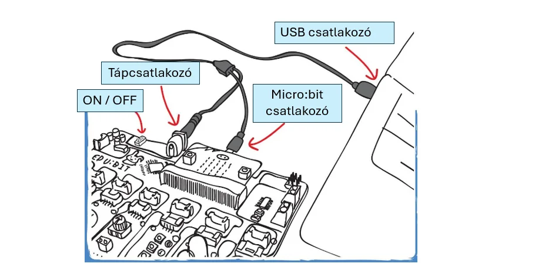
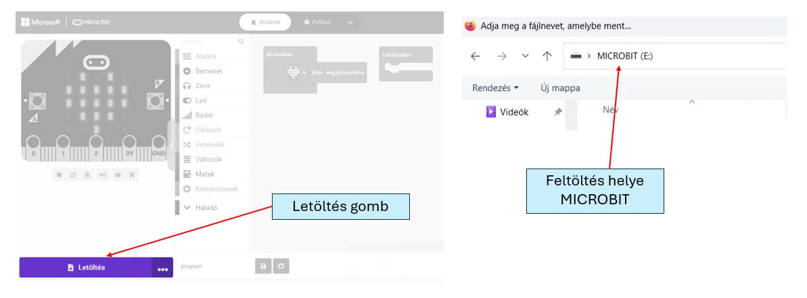

# 🔌 Edubit csatlakoztatása és letöltés

Kapcsold össze a micro:bitet az Edubittel, majd USB-kábellel csatlakoztasd a számítógéphez.

<figure class="tool-figure tool-figure--wide"></figure>

A MakeCode-ban a **Letöltés** gombbal töltsd át a programot. Ha a böngésző és az eszköz támogatja, a párosítás után közvetlenül is küldheted a programot a micro:bitre.

<figure class="tool-figure tool-figure--wide"></figure>

!!! note
    Ha csak próbaprogramot készítesz, a `.hex` fájlt külön is elmentheted.

[← Vissza az Edubit eszköztárhoz](../)
