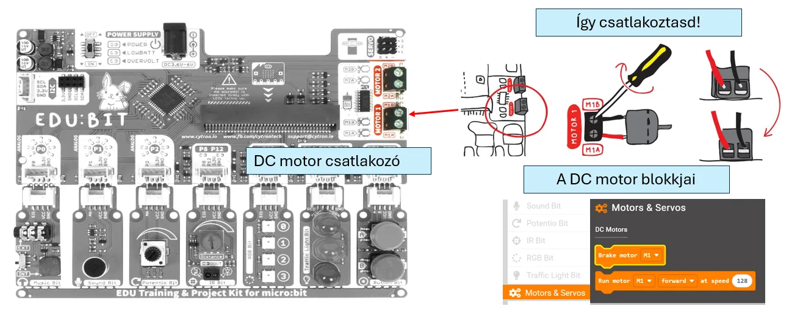
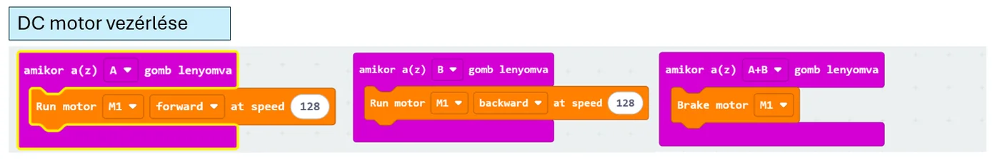

# 🌀 DC motor

A DC motor **folyamatos forgó mozgást** végez. Ventilátorhoz, kerékhez vagy más folyamatosan forgó elemhez használható.

<figure class="tool-figure tool-figure--wide"></figure>

## 🧪 Interaktív próba

  
<strong>Kísérletezz a forgás irányával és sebességével!</strong> A szimulátorban külön hardver nélkül is láthatod a vezérlés hatását.

  
<a href="https://bsuszter.github.io/dc_motor/" target="_blank" rel="noopener noreferrer"><strong>🌀 DC motor szimulátor megnyitása ↗</strong></a>

<iframe src="https://bsuszter.github.io/dc_motor/" title="DC motor interaktív szimulátor" style="width:100%;min-height:560px;border:1px solid #c9d9e8;border-radius:14px;background:#fff;" loading="lazy"></iframe>

A programban a motor iránya és sebessége vezérelhető.

<figure class="tool-figure tool-figure--wide"></figure>

!!! tip
    Ha pontos szögbe szeretnél állítani valamit, ne DC motort, hanem szervómotort válassz.

[← Vissza az Edubit eszköztárhoz](../)
