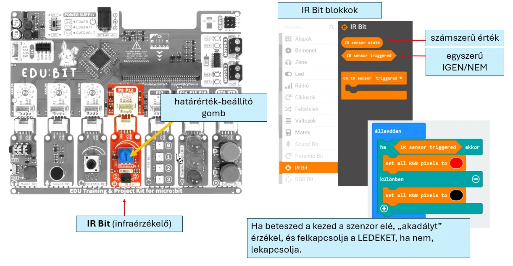

# 👀 IR Bit

Az IR Bit infravörös fényt bocsát ki, majd a visszaverődést érzékeli. Használható **akadály vagy közelség érzékelésére**, illetve fekete és világos felületek megkülönböztetésére.

<figure class="tool-figure tool-figure--wide"></figure>

!!! tip
    Az érzékelés eredménye függhet a tárgy színétől, felületétől és távolságától. A saját építésedben mindig próbáld ki több helyzetben.

[← Vissza az Edubit eszköztárhoz](../)
