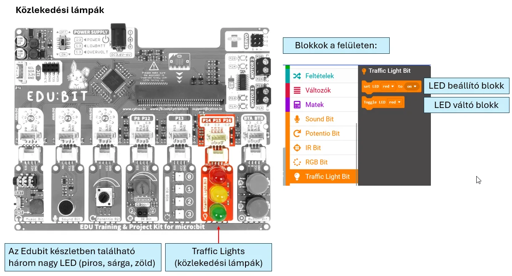
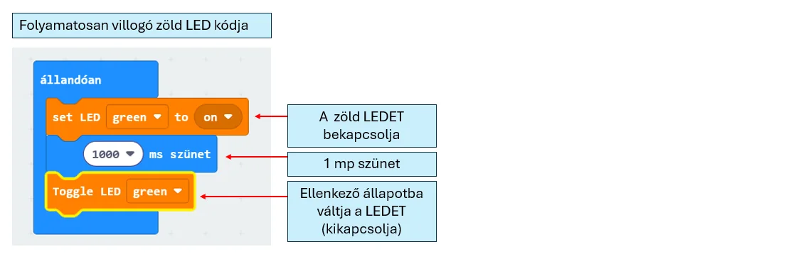

# 🚦 Közlekedési LED-ek

A Traffic Light Bit három külön LED-del ad egyértelmű **piros–sárga–zöld** visszajelzést. Állapotjelzéshez és közlekedési lámpához is használható.

<figure class="tool-figure tool-figure--wide"></figure>

Az egyes színeket külön tudod be- és kikapcsolni.

<figure class="tool-figure tool-figure--wide"></figure>

Ha hosszabb jelzéssort készítesz, érdemes az ismétlődő részeket **függvényekbe** szervezni.

<figure class="tool-figure tool-figure--wide"></figure>

!!! tip
    A közlekedési LED-ek akkor jók, ha három jól elkülöníthető állapotot akarsz megmutatni.

[← Vissza az Edubit eszköztárhoz](../)
