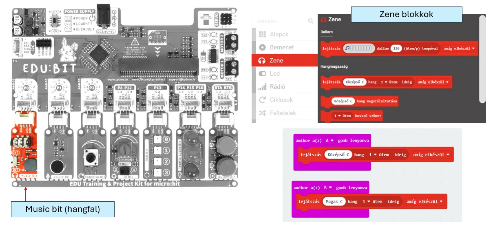

# 🔊 Music Bit

A Music Bit hangszóróként működik. Rövid hangjelzést, visszajelzést vagy egyszerű dallamot adhatsz vele.

<figure class="tool-figure tool-figure--wide"></figure>

!!! warning
    Gondoskodj a hang leállításáról is, különben a program könnyen folyamatos hangot adhat.

!!! example
    Potméterrel hangerőszabályzó is készíthető. Ilyenkor a bemeneti 0–1023 tartományt a kívánt hangerőtartományhoz kell igazítani.

[← Vissza az Edubit eszköztárhoz](../)
