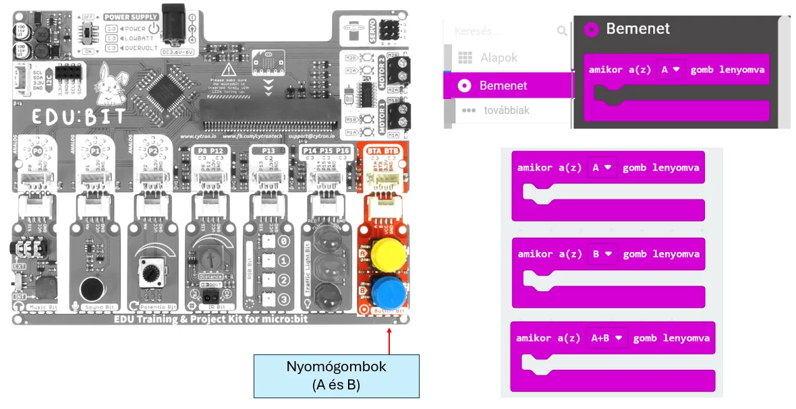

# 🔘 Nyomógombok

Az Edubit nyomógombjai egyszerű digitális bemenetek. Akkor használd őket, ha a felhasználó egy konkrét eseményt szeretne kiváltani: indítás, váltás, nyitás, jelzés vagy más művelet.

<figure class="tool-figure tool-figure--wide"></figure>

!!! tip
    A gomb **eseményt** ad, nem folyamatosan változó értéket. Ha fokozatos beállításra van szükséged, inkább potmétert használj.

[← Vissza az Edubit eszköztárhoz](../)
