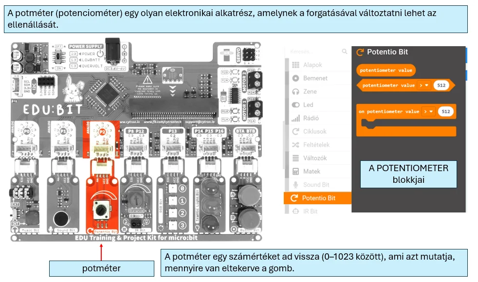
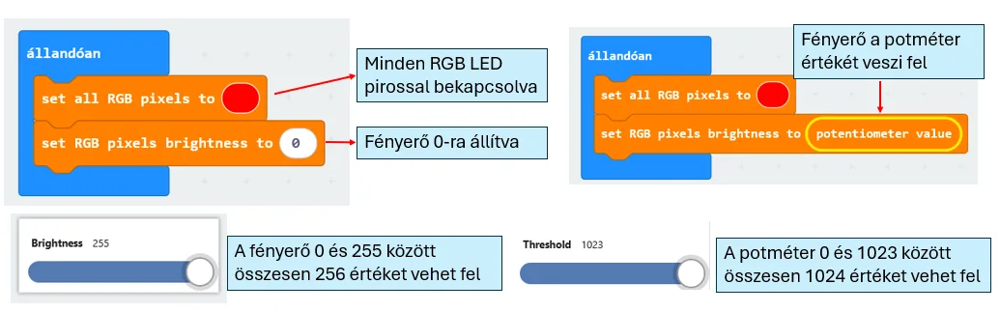
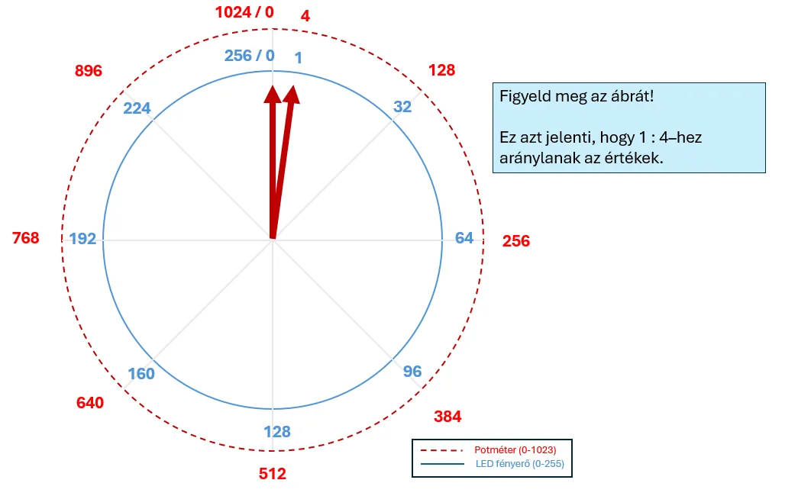

# 🎚️ Potméter

A potméter egy forgatható bemenet. Az értéke **0 és 1023** között változik, ezért jól használható beállításhoz, szabályozáshoz vagy egy valódi érzékelő modellezéséhez.

<figure class="tool-figure tool-figure--wide"></figure>

## 🧪 Interaktív próba

  
<strong>Próbáld ki, hogyan változik a bemeneti érték!</strong> A szimulátor segít megérteni a 0–1023 tartományt és az átskálázást.

  
<a href="https://bsuszter.github.io/potmeter/" target="_blank" rel="noopener noreferrer"><strong>🎚️ Potméter szimulátor megnyitása ↗</strong></a>

<iframe src="https://bsuszter.github.io/potmeter/" title="Potméter interaktív szimulátor" style="width:100%;min-height:560px;border:1px solid #c9d9e8;border-radius:14px;background:#fff;" loading="lazy"></iframe>

<figure class="tool-figure tool-figure--wide"></figure>

Ha a potméter értékét olyan eszközhöz használod, amelynek más a tartománya, **át kell skálázni**. Például a H5P mintájában a 0–1023 tartományt a 0–255 fényerőhöz osztással igazítjuk.

<figure class="tool-figure tool-figure--wide"></figure>

!!! example
    1024 / 256 = 4, ezért a potméter értékének 4-gyel osztása közel a 0–255 tartományt adja.

[← Vissza az Edubit eszköztárhoz](../)
