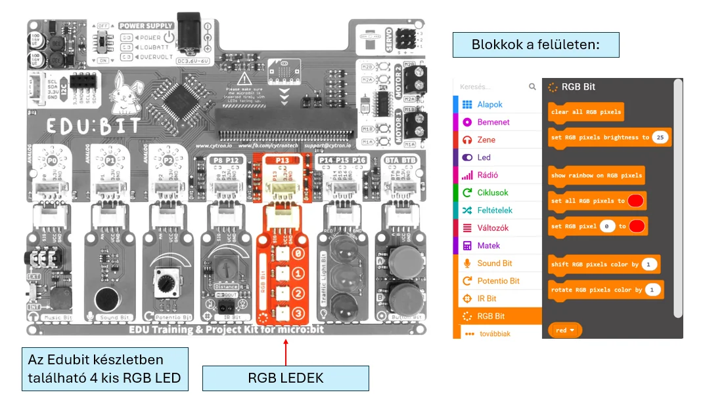
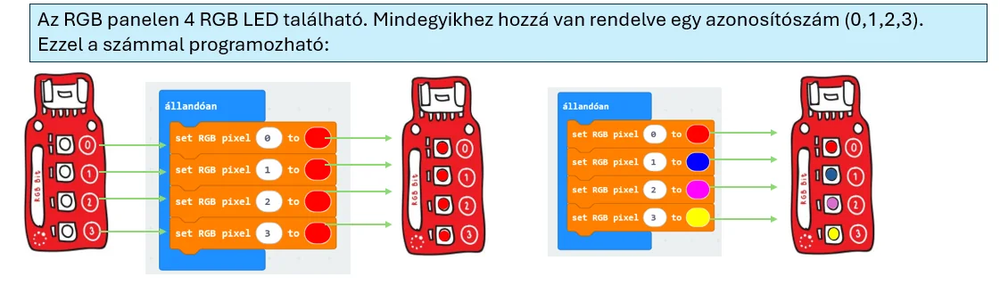
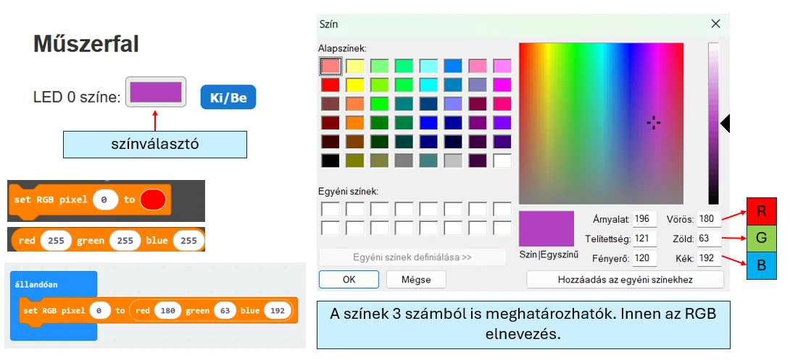
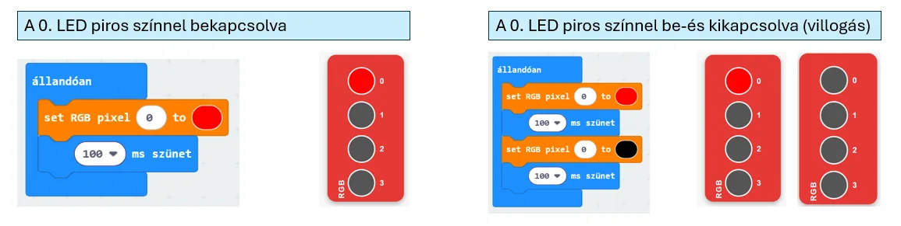

# 🌈 RGB LED-ek

Az RGB LED-ekkel többféle színt és fényerőt állíthatsz be. Jó választás, ha nemcsak három rögzített állapotot, hanem sokféle vizuális visszajelzést szeretnél.

<figure class="tool-figure tool-figure--wide"></figure>

## 🧪 Interaktív próba

  
<strong>Kísérletezz a színekkel és a működés logikájával!</strong> A szimulátorban azonnal látod, hogyan változik az RGB LED-ek állapota.

  
<a href="https://bsuszter.github.io/rgb_led/" target="_blank" rel="noopener noreferrer"><strong>🌈 RGB LED szimulátor megnyitása ↗</strong></a>

<iframe src="https://bsuszter.github.io/rgb_led/" title="RGB LED interaktív szimulátor" style="width:100%;min-height:560px;border:1px solid #c9d9e8;border-radius:14px;background:#fff;" loading="lazy"></iframe>

A LED-ek külön-külön is vezérelhetők, ezért futófény és más animáció is készíthető.

<figure class="tool-figure tool-figure--wide"></figure>

<figure class="tool-figure tool-figure--wide"></figure>

Összetettebb fényanimációnál jól használható az **indexelt ciklus**.

<figure class="tool-figure tool-figure--wide"></figure>

!!! tip
    Ha egy érték növekedését színnel vagy fényerővel szeretnéd megmutatni, az RGB LED különösen hasznos.

[← Vissza az Edubit eszköztárhoz](../)
