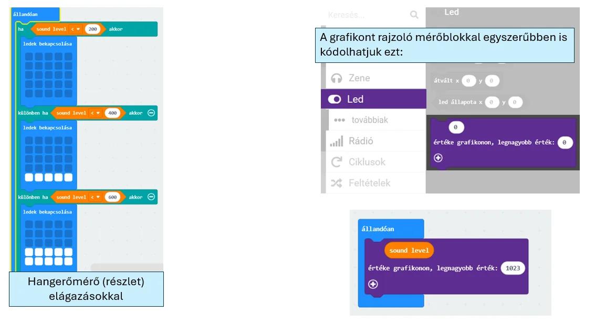

# 🎤 Sound Bit

A Sound Bit mikrofonként érzékeli a környezeti hang vagy zaj erősségét. Használható tapskapcsolóhoz, zajjelzőhöz vagy olyan rendszerhez, amely a hangerő alapján reagál.

<figure class="tool-figure tool-figure--wide"></figure>

## 🧪 Interaktív próba

  
<strong>Próbáld ki a hangerőre reagáló működést!</strong> A szimulátor segít megérteni, hogyan használható egy hangérték bemenetként és küszöbértékes döntéshez.

  
<a href="https://bsuszter.github.io/soundbit/" target="_blank" rel="noopener noreferrer"><strong>🎤 Sound Bit szimulátor megnyitása ↗</strong></a>

<iframe src="https://bsuszter.github.io/soundbit/" title="Sound Bit interaktív szimulátor" style="width:100%;min-height:560px;border:1px solid #c9d9e8;border-radius:14px;background:#fff;" loading="lazy"></iframe>

!!! example
    Tapskapcsolónál megadhatsz egy küszöbértéket. Ha a mért hangerő ennél nagyobb, a program fényt, hangot vagy mozgást indíthat.

!!! tip
    A környezet alapzaja változhat, ezért a küszöbértéket mindig próbáld ki a tényleges helyszínen.

[← Vissza az Edubit eszköztárhoz](../)
