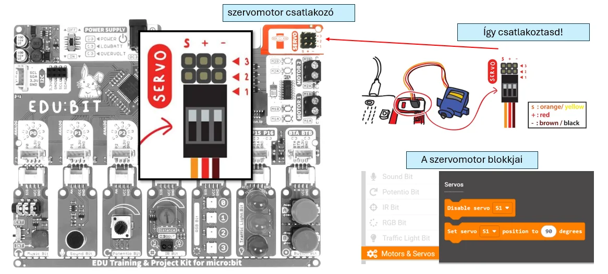
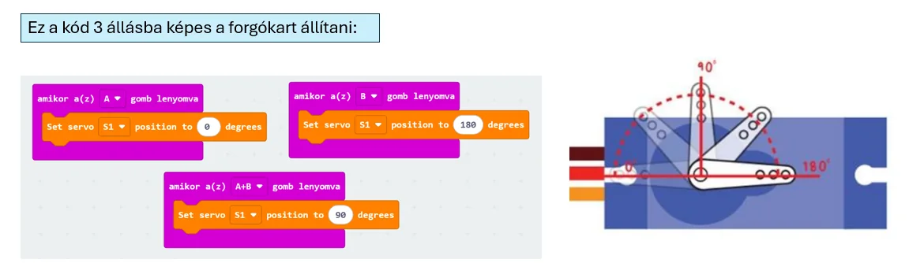

# ⚙️ Szervómotor

A szervómotor nem folyamatosan forog, hanem egy meghatározott **szögbe állítható**. Általában 0° és 180° közötti helyzetek használhatók.

Jó például ajtó, kar, mutató, robotfej vagy más pontosan pozicionálható elem mozgatására.

<figure class="tool-figure tool-figure--wide"></figure>

<figure class="tool-figure tool-figure--wide"></figure>

!!! example
    Ha potméterrel vezérled, a 0–1023 bemeneti tartományt a szervó 0–180° tartományához kell igazítani.

[← Vissza az Edubit eszköztárhoz](../)
