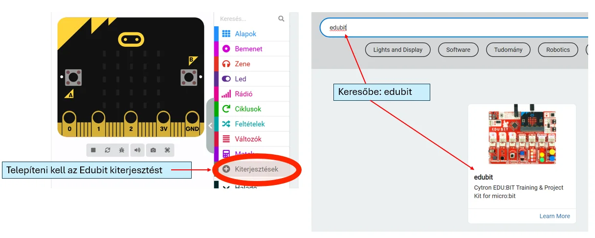
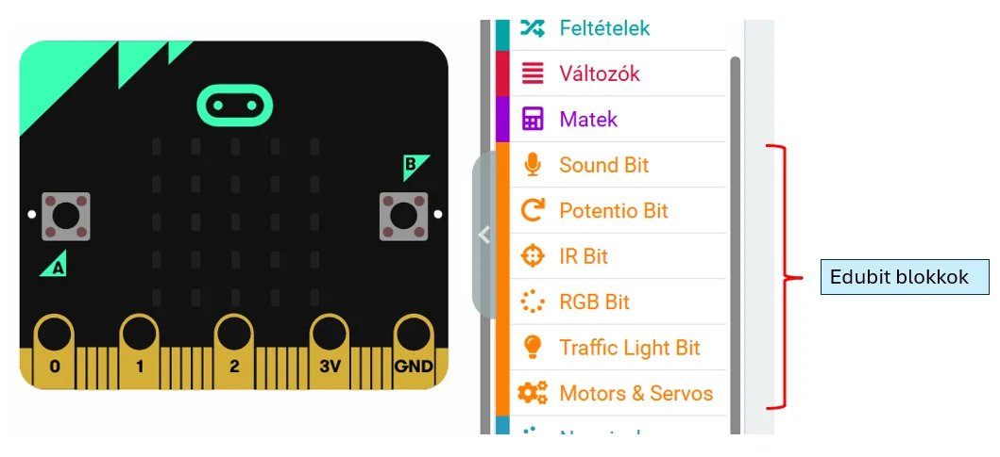

# ➕ Edubit telepítése

A [MakeCode micro:bit felületén](https://makecode.microbit.org/){ target="_blank" rel="noopener" } nyisd meg a projektedet, majd add hozzá az **Edubit bővítményt**.

<figure class="tool-figure tool-figure--wide"></figure>

A keresőben keresd meg az Edubit bővítményt, majd kattints rá. Ezután az Edubithoz tartozó blokkok külön kategóriában jelennek meg.

<figure class="tool-figure tool-figure--wide"></figure>

!!! tip
    Az Edubit blokkokat ugyanabban a MakeCode-projektben használod, mint a micro:bit alapblokkjait.

[← Vissza az Edubit eszköztárhoz](../)
