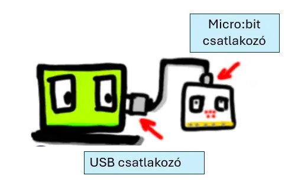
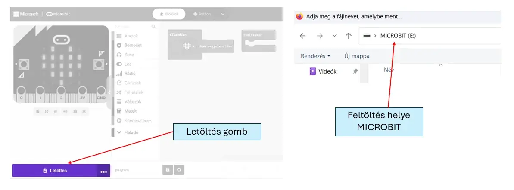

# 🔌 Csatlakozás és letöltés

## A micro:bit csatlakoztatása

USB-kábellel kösd össze a micro:bitet és a számítógépet. A kábel számítógép felőli végét az USB-csatlakozóba, a másik végét a micro:bit csatlakozójába dugd.

<figure class="tool-figure tool-figure--wide"></figure>

## A program letöltése

A MakeCode-ban kattints a **Letöltés** gombra, majd válaszd ki a **MICROBIT** meghajtót feltöltési helyként.

<figure class="tool-figure tool-figure--wide"></figure>

!!! note
    Ha csak a szimulátorban dolgozol, a programot `.hex` fájlként is le tudod tölteni és később újra megnyitni.

[← Vissza a micro:bit eszköztárhoz](../)
