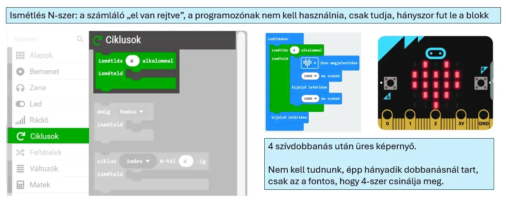

# 🔁 Egyszerű számlálós ciklus

A **Ciklusok** kategóriában az **ismétlés … alkalommal** blokk ugyanazt a blokkcsoportot meghatározott számú alkalommal futtatja le.

<figure class="tool-figure tool-figure--wide"></figure>

A H5P példájában egy szívből álló LED-kép négyszer jelenik meg egymás után.

!!! tip
    Ezt a ciklust akkor használd, ha tudod, **hányszor** szeretnél valamit megismételni, de nincs szükséged az ismétlések sorszámára.

[← Vissza a micro:bit eszköztárhoz](../)
