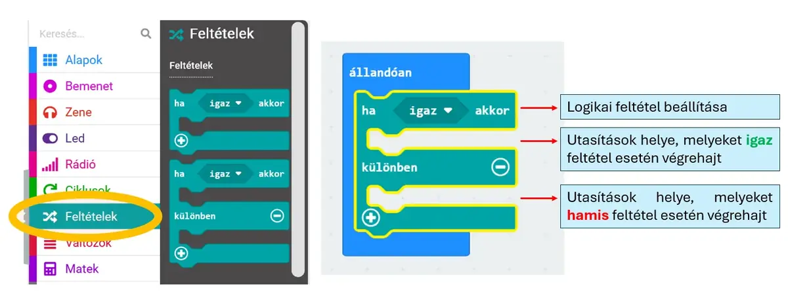
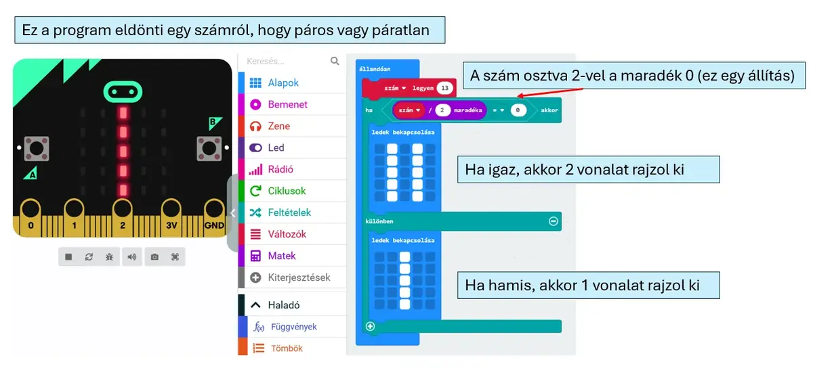
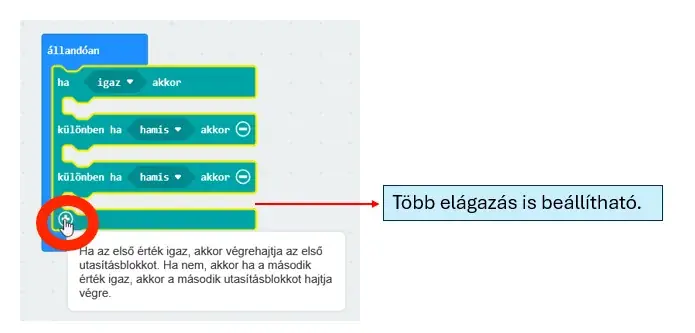

# 🔀 Feltételek és elágazás

A **Feltételek** kategóriában találod a döntéshez szükséges blokkokat. A program egy logikai feltételt vizsgál meg, majd annak eredménye alapján választ ágat.

<figure class="tool-figure tool-figure--wide"></figure>

## Két különböző reakció

A példában a program egy szám párosságáról dönt: maradékos osztással vizsgálja, hogy a maradék 0-e, majd az igaz és hamis ágban más LED-képet jelenít meg.

<figure class="tool-figure tool-figure--wide"></figure>

## Több állapot

A **+** gombbal további ágak is hozzáadhatók. Így egynél több feltétel és három vagy több állapot is kezelhető.

<figure class="tool-figure tool-figure--wide"></figure>

!!! example
    Okosteremnél ilyen három állapot lehet: **hideg / megfelelő / meleg**.

[← Vissza a micro:bit eszköztárhoz](../)
