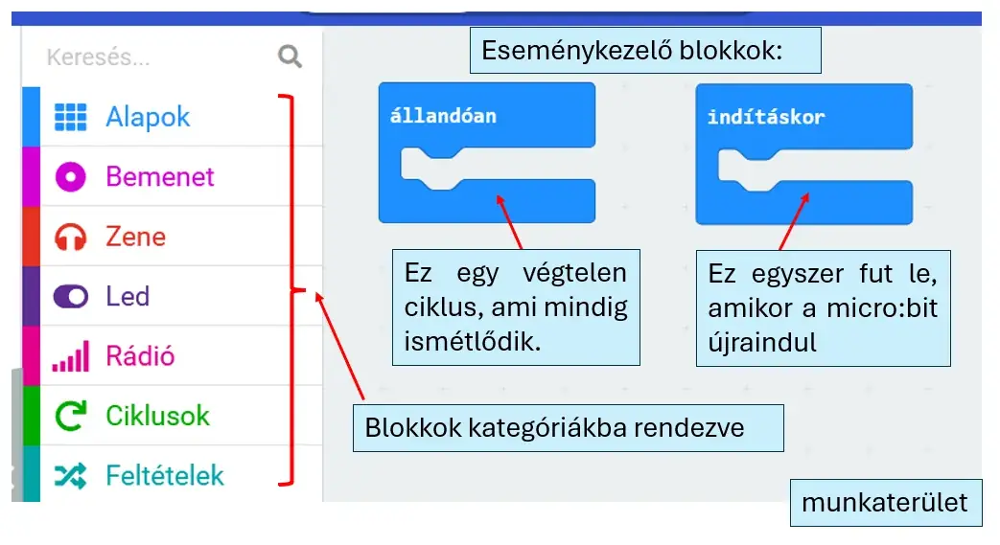

# ⚡ Eseménykezelés

A MakeCode programja eseményekre épül. Az **Alapok** kategóriában két alapvető blokkot találsz:

- **indításkor** – egyszer fut le, amikor a program elindul;
- **állandóan** – újra és újra végrehajtja a benne lévő blokkokat.

<figure class="tool-figure tool-figure--wide"></figure>

!!! tip "Melyiket használd?"
    Egyszeri kezdőbeállításhoz az **indításkor**, folyamatos érzékeléshez és reagáláshoz az **állandóan** blokk a jó kiindulópont.

[← Vissza a micro:bit eszköztárhoz](../)
