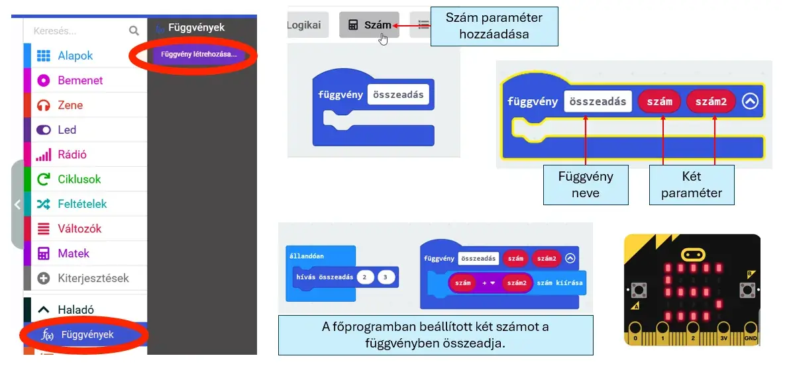

# 🧩 Függvény paraméterrel

A paraméter olyan adat, amelyet a függvény meghívásakor adsz át a függvénynek. Így ugyanaz a függvény különböző értékekkel is használható.

<figure class="tool-figure tool-figure--wide"></figure>

A H5P példájában a függvény számszerű paramétereket kap, és a főprogram a beállított értékeket adja át neki.

!!! tip
    Paraméterrel ugyanazt a részfeladatot rugalmasabban használhatod: nem kell minden eltérő értékhez új függvényt készíteni.

[← Vissza a micro:bit eszköztárhoz](../)
