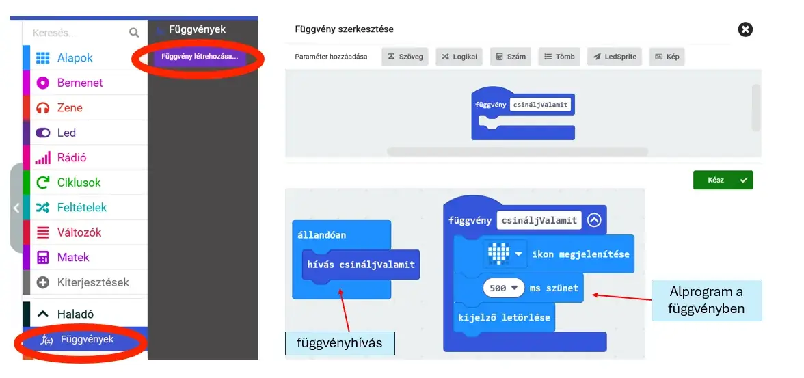

# 🧩 Függvény paraméter nélkül

A függvény kisebb alprogram: egy jól elkülöníthető részfeladatot végez el, és a saját nevével hívható meg a programból.

A **Haladó → Függvények** résznél készíthetsz új függvényt.

<figure class="tool-figure tool-figure--wide"></figure>

A H5P példájában a `szamlalo` függvény végzi el a kijelzéshez kapcsolódó műveletet, a főprogram pedig csak meghívja.

!!! tip
    Függvényt akkor érdemes készíteni, ha ugyanazt a feladatot több helyen is el akarod végezni, vagy áttekinthetőbbé szeretnéd tenni a programot.

[← Vissza a micro:bit eszköztárhoz](../)
