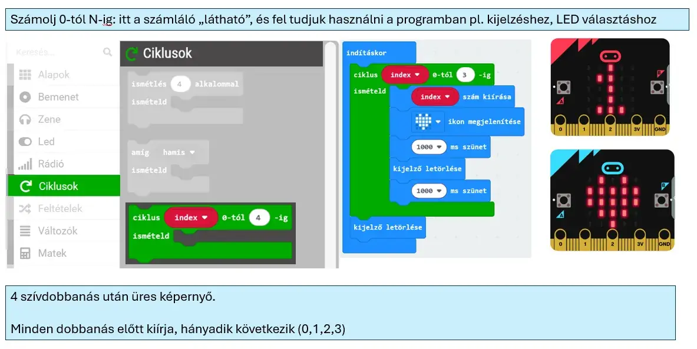

# 🔢 Indexelt számlálós ciklus

Az indexelt ciklus ismétlés közben egy számlálóváltozó értékét is biztosítja. A H5P-anyag példájában ez az `index`, amelynek értéke sorban változik.

<figure class="tool-figure tool-figure--wide"></figure>

!!! example
    Ha 4 ismétlést állítasz be, az index értékei egymás után használhatók például kijelzésre vagy számításra.

!!! tip
    Akkor válaszd ezt a ciklust, ha nemcsak ismételni akarsz, hanem az is számít, **hanyadik ismétlésnél** tart a program.

[← Vissza a micro:bit eszköztárhoz](../)
