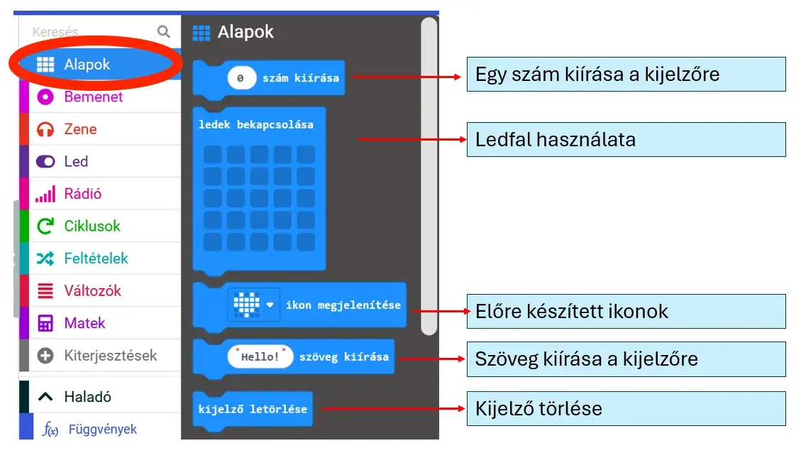

# 🔲 Kijelző és kiírás

Az **Alapok** kategóriában többféle módon adhatsz látható visszajelzést a micro:bit 5×5-ös LED-kijelzőjén:

- szám kiírása;
- saját LED-kép megrajzolása;
- előre elkészített ikon megjelenítése;
- szöveg kiírása;
- a kijelző törlése.

<figure class="tool-figure tool-figure--wide"></figure>

!!! tip
    Teszteléskor különböző állapotokhoz használj jól megkülönböztethető ikonokat vagy rövid szöveget.

[← Vissza a micro:bit eszköztárhoz](../)
