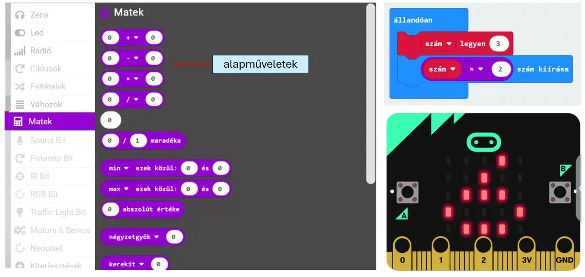

# ➗ Matematikai műveletek

A **Matek** kategóriában találod a számokkal végzett alapműveleteket és más matematikai blokkokat. Ezeket változókkal és szenzorértékekkel is használhatod.

<figure class="tool-figure tool-figure--wide"></figure>

!!! example
    Egy értéket növelhetsz, csökkenthetsz, eloszthatsz vagy maradékos osztással vizsgálhatsz. A művelet eredményét kiírhatod, változóba teheted vagy feltételben használhatod.

[← Vissza a micro:bit eszköztárhoz](../)
