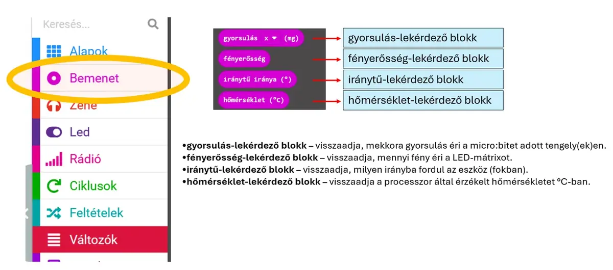

# 🌡️ Szenzorok lekérdezése

A **Bemenet** kategóriában olyan blokkok vannak, amelyek a micro:bit érzékelőinek aktuális értékét adják vissza.

<figure class="tool-figure tool-figure--wide"></figure>

A H5P-anyagban szereplő fő lekérdezések:

- **gyorsulás** – megadja, mekkora gyorsulás éri a micro:bitet a választott tengelyen;
- **fényerősség** – megadja, mennyi fény éri a LED-mátrixot;
- **iránytű iránya** – megadja az eszköz irányát fokban;
- **hőmérséklet** – a processzor által érzékelt hőmérsékletet adja vissza °C-ban.

!!! tip "Szimulátor"
    A MakeCode szimulátorában több bemeneti érték gyorsan változtatható. Ez különösen hasznos teszteléskor.

[← Vissza a micro:bit eszköztárhoz](../)
