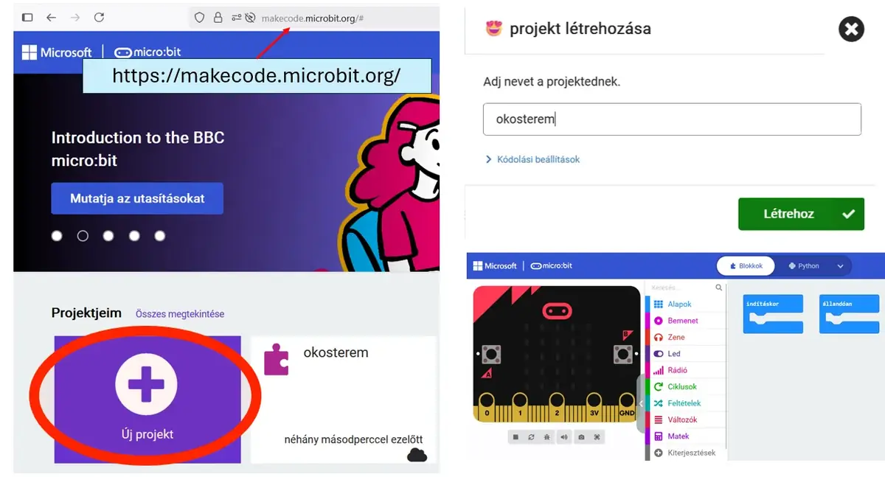

# ➕ Új micro:bit projekt

Nyisd meg a [MakeCode micro:bit felületét](https://makecode.microbit.org/){ target="_blank" rel="noopener" }, majd válaszd az **Új projekt** lehetőséget. Adj beszédes nevet a projektnek, végül kattints a **Létrehozás** gombra.

<figure class="tool-figure tool-figure--wide"></figure>

!!! tip "Jó projektnév"
    A névből később is derüljön ki, mit készítettél. Például: `okosterem-homerseklet`.

[← Vissza a micro:bit eszköztárhoz](../)
