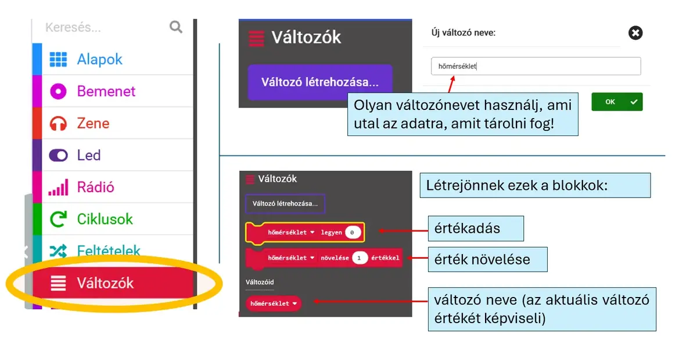
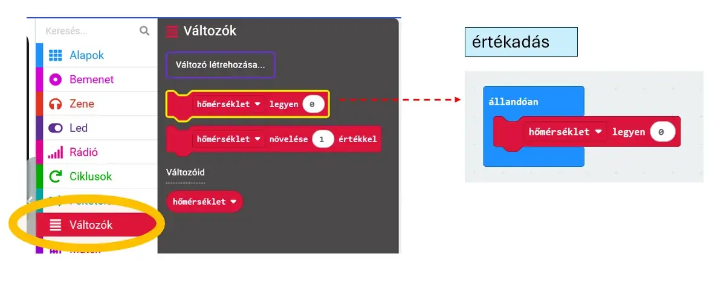

# 📦 Változók

A változó olyan névvel ellátott tároló, amelyben a program futása közben adatot tarthatsz.

A **Változók** kategóriában a **Változó létrehozása** gombbal készíts új változót.

<figure class="tool-figure tool-figure--wide"></figure>

A létrehozás után három fontos művelet jelenik meg:

- **értékadás** – beállítja a változó értékét;
- **érték növelése** – módosítja az aktuális értéket;
- **a változó értéke** – felhasználható más blokkokban.

<figure class="tool-figure tool-figure--wide"></figure>

!!! example
    Ha a rendszer hőmérséklettel dolgozik, egy `homerseklet` változóban tárolhatod a mért vagy szimulált értéket.

[← Vissza a micro:bit eszköztárhoz](../)
