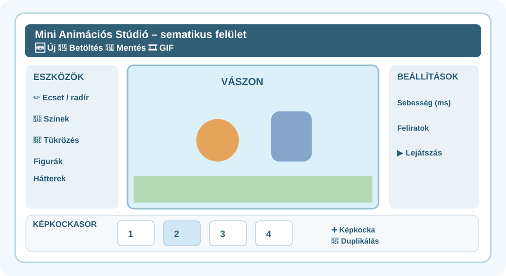

# ✏️ Szereplők, hátterek és rajzolás

[🎨 Mini Animációs Stúdió megnyitása ↗](https://interaktivfeladat.hu/jatek/animacio/){: target="_blank" rel="noopener noreferrer" }

!!! info "Így használd a segítséget"
    Nézd meg az ábrát és a műveletet, majd térj vissza a saját animációdhoz! Az ábrák a kezelőfelület **sematikus rajzai**, nem képernyőképek.

## Négyféle építőelem

- **Kész figurák és tárgyak:** a gyűjteményből választva helyezhetsz a jelenetbe szereplőket, állatokat, tárgyakat.
- **Saját importált kép vagy háttér:** a számítógépedről választott képpel egyedivé teheted a szereplőket vagy a jelenet helyszínét.
- **Háttér:** segít megmutatni, hol játszódik a történet. A következő képkockán lehet ugyanaz, vagy egy új jelenet részeként eltérő.
- **Rajzolás:** ecsettel saját részleteket tehetsz a vászonra; a **radírral** törölhetsz a rajzból.

## Egy szereplő megmozdítása

1. Válassz egy figurát, helyezd el a vásznon!
2. Duplikáld a képkockát!
3. A másolaton változtass a szereplő **helyzetén**, szükség esetén a **méretén** vagy **irányán**!
4. A vízszintes **tükrözés** segíthet, ha a figura a másik irányba fordul.

## 💬 Feliratok

A feliratok készítéséhez külön, lépésenkénti segítséget találsz: [**💬 Felirat készítése – Szövegdoboz**](../feliratok/).

!!! tip "Saját kép vagy háttér feltöltése"
    A program kép- és háttérfeltöltésével a gépen tárolt fájlt is használhatod. A képek látványosabbá tehetik a történetet, de a szereplők mozgását így is képkockánként kell megalkotnod. Csak olyan képet tölts fel, amelyet jogszerűen használhatsz, és amelyen nincs olyan személyes adat, amelyet nem szeretnél megosztani.

[→ Lejátszás és mentés](../lejatszas-mentes/)
