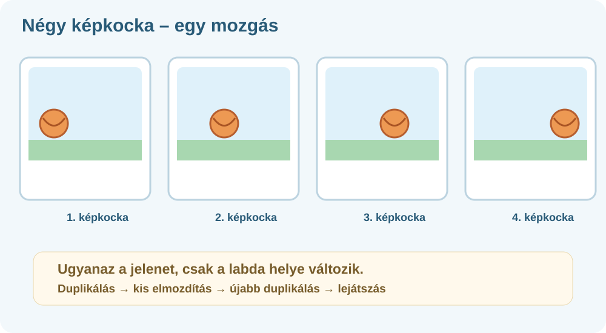

# 🎞️ Új képkocka vagy duplikálás?

[🎨 Mini Animációs Stúdió megnyitása ↗](https://interaktivfeladat.hu/jatek/animacio/){: target="_blank" rel="noopener noreferrer" }

!!! info "Így használd a segítséget"
    Nézd meg az ábrát és a műveletet, majd térj vissza a saját animációdhoz! Az ábrák a kezelőfelület **sematikus rajzai**, nem képernyőképek.

## A két gomb nem ugyanazt csinálja

| Gomb | Mi történik? | Mikor jó? |
|---|---|---|
| **➕ Képkocka** | Új, üres képkockát készít. | Teljesen más jelenetet építesz. |
| **📄 Duplikálás** | Lemásolja a kijelölt képkocka jelenetét. | Kicsit mozdítanál valamit; folyamatos mozgást szeretnél. |

### A legegyszerűbb mozgás

1. Tedd a labdát a vászon bal oldalára!
2. **Duplikáld** a képkockát!
3. Az új képkockán mozdítsd a labdát kissé jobbra!
4. Ismételd meg többször!
5. Nyomd meg a **▶ Lejátszás** gombot!

!!! warning "Gyakori hiba"
    Ha minden új képkockán más-más helyről indítod a szereplőt, a mozgás ugrálni fog. Duplikálj, és egyszerre csak egy kisebb változtatást végezz!

[→ Szereplők és rajzolás](../elemek-rajz/)
