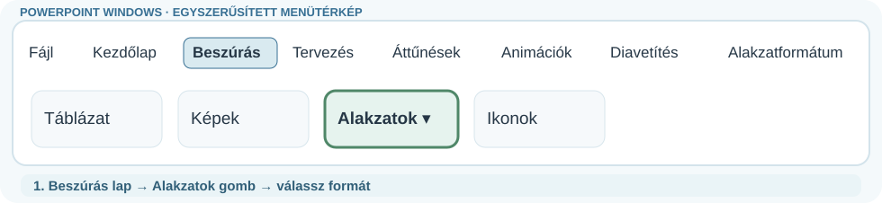
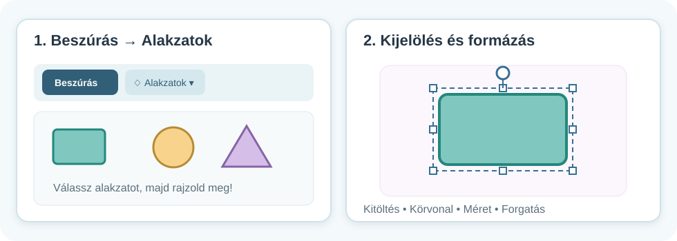
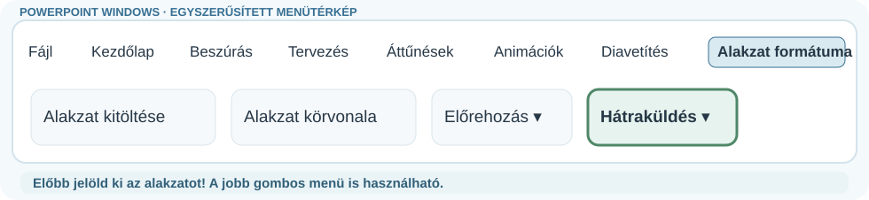
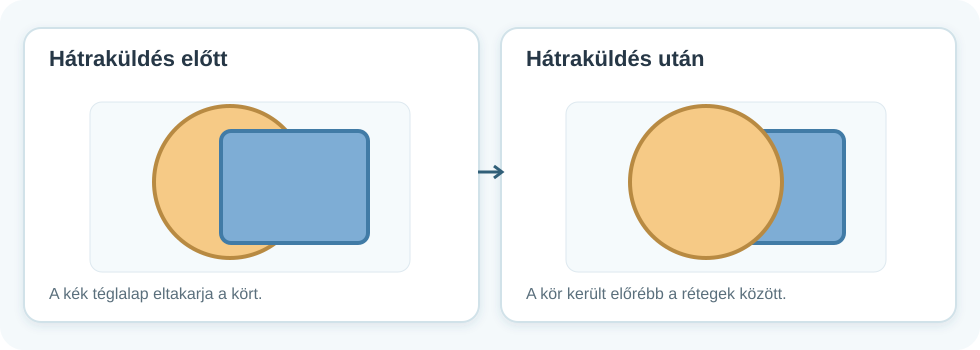
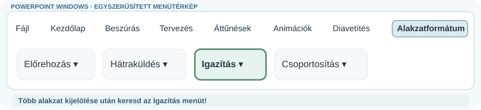
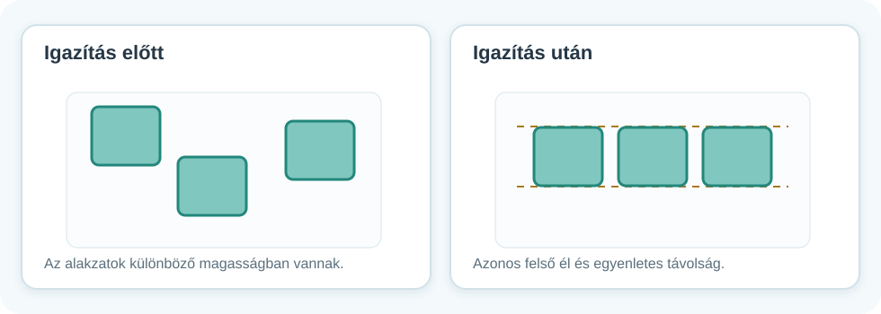
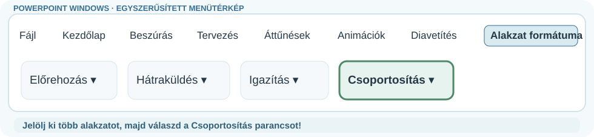
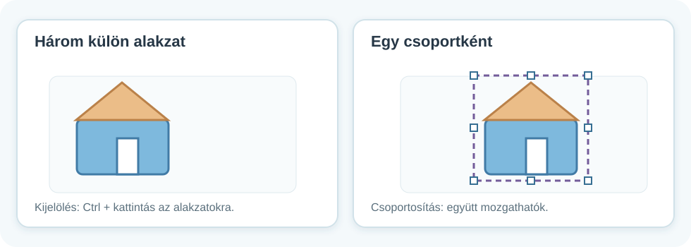

# 🔷 Alakzatok, igazítás és csoportosítás

DIGITÁLIS ESZKÖZTÁR · POWERPOINT<h2>Rajzolj alakzatokból – pontosan!</h2>
Egy jó ábra nemcsak szép, hanem jól elrendezett is. Nézd meg a képeket, majd próbáld ki a műveleteket a saját bemutatódban!

🔷

🧩 4 alapművelet🖱️ Kipróbálható lépések💻 Windowsos PowerPoint

!!! info "Hogyan olvasd ezt az útmutatót?"
    Először a **menütérképen** keresd meg, hová kell kattintani. Utána a nagyobb ábra megmutatja, mi történik a dián. A menütérképek **egyszerűsített szemléltető rajzok, nem képernyőfotók**; az ikonok elhelyezkedése a telepített PowerPoint változatától és az ablak szélességétől kissé eltérhet. Ha nem látod az **Alakzat formátuma** fület, előbb kattints egy alakzatra!

## 1. Alakzat beszúrása és formázása

<figure class="tool-figure tool-figure--wide"><figcaption>Ezt keresd: <strong>Beszúrás → Alakzatok</strong>.</figcaption></figure>

1
<strong>Beszúrás → Alakzatok</strong>Válassz téglalapot, kört, háromszöget vagy más alakzatot.

2
<strong>Rajzold meg!</strong>Kattints a diára, és az egérrel húzd megfelelő méretűre az alakzatot.

3
<strong>Formázd!</strong>Kijelölés után állítsd a kitöltőszínt, körvonalat, méretet vagy forgatást. A menü neve verziótól függhet.

<figure class="tool-figure tool-figure--wide"><figcaption>Az alakzatra kattintva megjelennek a méretező fogantyúk. A képre kattintva nagyobban is megnézheted.</figcaption></figure>

!!! tip "Kis trükk"
    Sok PowerPoint-verzióban a **Shift** lenyomva tartásával szabályos kört vagy négyzetet rajzolhatsz.

## 2. Előrehozás és hátraküldés – melyik látszik felül?

<figure class="tool-figure tool-figure--wide"><figcaption>Előbb jelöld ki a formát! Utána: <strong>Alakzat formátuma → Előrehozás / Hátraküldés</strong>.</figcaption></figure>

Két alakzat takarhatja egymást. Ilyenkor a **rétegsorrend** határozza meg, melyik jelenik meg elöl. Jelöld ki az alakzatot, és keresd az **Előrehozás / Hátraküldés** parancsot!

<figure class="tool-figure tool-figure--wide"><figcaption>Az alakzatok nem változtak meg, csak a sorrendjük: mást takarnak el.</figcaption></figure>

## 3. Igazítás és egyenletes elosztás

<figure class="tool-figure tool-figure--wide"><figcaption>Előbb legalább két alakzatot jelölj ki! Utána: <strong>Alakzat formátuma → Igazítás</strong>. Az almenüben válaszd ki azt is, mihez igazítasz.</figcaption></figure>

Ha több alakzatot használsz, könnyű ferdén, különböző távolságra elhelyezni őket.

1. Jelöld ki az összeigazítandó alakzatokat (**Ctrl + kattintás** egymás után).
2. Nyisd meg az **Alakzat formátuma → Igazítás** menüt.
3. Ha az alakzatokat **egymáshoz** akarod rendezni, előbb válaszd a **Kijelölt objektumok igazítása** lehetőséget.
4. Ezután válassz például **Felülre igazítás** vagy **Vízszintes elosztás** műveletet.

!!! warning "Nagyon fontos: mihez igazítunk?"
    - **Igazítás diához:** a kijelölt alakzatot vagy alakzatokat a **teljes dia** széléhez, közepéhez igazítja.
    - **Kijelölt objektumok igazítása:** a több kijelölt alakzatot **egymáshoz** igazítja.
    
    Az általad készített rajz részeit általában **egymáshoz** kell igazítanod. Ha ez a lehetőség szürke, először jelölj ki legalább **két alakzatot**!

<figure class="tool-figure tool-figure--wide"><figcaption>Az igazítás azonos vonalba rendezi, az elosztás egyenletes távolságra helyezi az alakzatokat.</figcaption></figure>

## 4. Csoportosítás – sok részből egyetlen rajz

<figure class="tool-figure tool-figure--wide"><figcaption>Előbb több alakzatot jelölj ki! Utána: <strong>Alakzat formátuma → Csoportosítás</strong>.</figcaption></figure>

Ha például egy házat három-négy alakzatból építesz, külön-külön mozgatva könnyen széteshet.

1. Jelöld ki az összetartozó alakzatokat (**Ctrl + kattintás**).
2. Válaszd az **Alakzat formátuma → Csoportosítás** parancsot (a jobb gombos menüben is megtalálhatod).
3. Mozgasd meg a rajzot: minden része együtt mozdul.

<figure class="tool-figure tool-figure--wide"><figcaption>A közös kijelölési keret jelzi, hogy a részeket együtt kezelheted.</figcaption></figure>

!!! info "Csoportbontás"
    Ha újra külön-külön szeretnéd szerkeszteni a részeket, keresd a **Csoportbontás** műveletet.

<strong>🎯 Próbáld ki most!</strong>Készíts egy házat tetővel, ablakkal és ajtóval! Igazítsd a részeket, változtasd a tető rétegsorrendjét, majd csoportosítsd az egész házat. Utána mozgasd arrébb egyetlen mozdulattal.

!!! info "Pixel vagy vektor?"
    A fénykép képpontokból épül fel. A PowerPoint alakzatai többnyire vektoros rajzelemek, ezért nagyításkor is élesek maradnak.

<a href="../">← Vissza a PowerPoint-eszköztárhoz</a>

