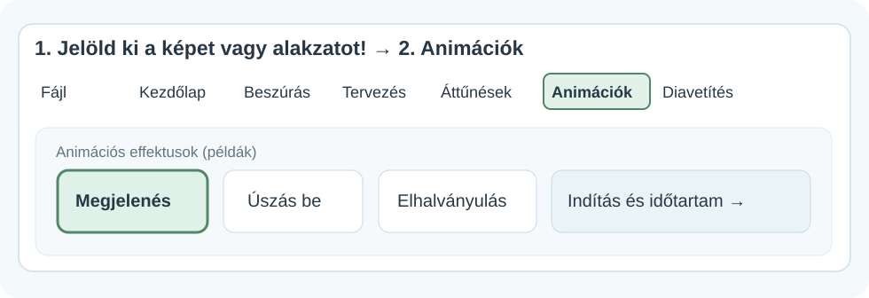
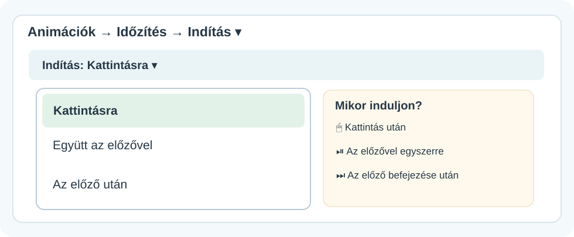
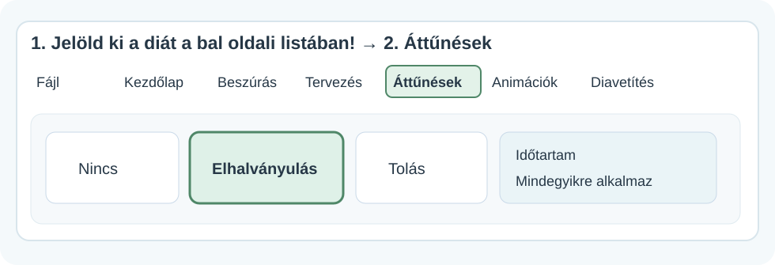

# ✨ Animációk és áttűnések

DIGITÁLIS ESZKÖZTÁR · POWERPOINT<h2>Mi mozog a bemutatóban?</h2>
Az animáció a dia egyik elemét változtatja meg. Az áttűnés két dia közötti váltás. Nézd meg a szemléltetést, aztán keresd meg a parancsokat a saját PowerPointodban!

✨

💻 Windowsos PowerPoint🧭 Menütérképek▶️ Mozgó szemléltetés

## 1. Animáció vagy áttűnés?

<figure class="tool-figure tool-figure--wide"><figcaption>A bal oldalon egy tájkép úszik be a diára; a jobb oldalon az egész következő dia betolódik. A mozgás ismétlődik, ha a böngésződ támogatja az SVG-animációt. Nem PowerPoint-képernyőfelvétel.</figcaption></figure>

| Animáció | Áttűnés |
| --- | --- |
| **Egy képpel, szöveggel vagy alakzattal** történik valami **ugyanazon a dián**. | **Az egész dia** jelenik meg vagy tűnik el, amikor **diát váltasz**. |
| Példa: egy tájkép oldalról beúszik. | Példa: a következő dia oldalról betolódik, és leváltja az előzőt. |
| Menü: **Animációk** | Menü: **Áttűnések** |

## 2. Animáció hozzáadása

<figure class="tool-figure tool-figure--wide"><figcaption>Előbb a dián jelöld ki azt az elemet, amelyet mozgatni szeretnél! Utána kattints az <strong>Animációk</strong> fülre.</figcaption></figure>

1
<strong>Jelöld ki az elemet!</strong>Kattints például egy képre, szövegdobozra vagy alakzatra.

2
<strong>Animációk → effektus kiválasztása</strong>Kezdésként próbáld a **Beúszás** effektust: a kép oldalról érkezik a diára.

3
<strong>Nézd meg az eredményt!</strong>Használd az Előnézet lehetőséget, majd próbáld ki a Diavetítés nézetben is.

!!! tip "Hol látod, hogy van animáció?"
    A PowerPoint általában kis **számozott jelölést** tesz az animált objektum mellé. Ha több animáció van, az **Animáció munkaablak** segíthet áttekinteni a sorrendjüket.

## 3. Mikor induljon az animáció?

Nem mindegy, hogy a kép magától megjelenik-e, vagy csak egy kattintás után!

<figure class="tool-figure tool-figure--wide"><figcaption>Keresd az <strong>Animációk → Időzítés → Indítás</strong> mezőt, és nyisd le a kis nyíllal!</figcaption></figure>

🖱️<strong>Kattintásra</strong>A következő kattintás indítja az effektust.

⏯️<strong>Együtt az előzővel</strong>Az előző animációval egyszerre indul.

⏭️<strong>Az előző után</strong>Az előző effektus befejeződése után, újabb kattintás nélkül indul.

!!! warning "A leggyakoribb meglepetés"
    Ha az animáció **Kattintásra** van állítva, a szerkesztőnézetben még nem feltétlenül úgy látod a folyamatot, ahogyan diavetítés közben történik. **Mindig próbáld ki diavetítésben!**

## 4. Áttűnés beállítása

<figure class="tool-figure tool-figure--wide"><figcaption>Az áttűnéshez a <strong>bal oldali dialistában a diát</strong> jelöld ki, ne a rajta lévő képet!</figcaption></figure>

1. A bal oldali diasoron kattints a módosítani kívánt diára.
2. Nyisd meg az **Áttűnések** fület.
3. Próbáld ki a **Tolás** áttűnést: az új dia oldalról érkezik.
4. Az **Időtartam** mezővel szabályozhatod, milyen gyorsan történjen a váltás.
5. Próbáld ki a diavetítést! Ha az összes diára szeretnéd ugyanazt az áttűnést, keresd a **Mindegyikre alkalmaz** parancsot.

!!! info "Figyeld meg!"
    A kijelölt **második dia** áttűnése azt szabályozza, hogyan érkezik meg a **második dia** az előző után.

## 5. Ne a mozgás legyen a főszereplő!

- Az animáció segítse a figyelem vezetését, ne vonja el a figyelmet a tartalomról.
- Egy rövid, egyszerű áttűnés gyakran jobb választás, mint sok különböző látványos effektus.
- A **Mozgásvonal** egy másik animációtípus: az elem megadott útvonalon mozoghat a dián.

<strong>🎯 Próbáld ki!</strong>Készíts két diát! Az elsőn jelenjen meg egy alakzat kattintásra. A második diára állíts be Tolás áttűnést. Diavetítés közben figyeld meg, melyik esetben egy elem, és melyik esetben a teljes dia változik!

<strong>✅ Ellenőrizd magad!</strong>
<label><input type="checkbox">Meg tudom mondani, mi a különbség animáció és áttűnés között.</label>
<label><input type="checkbox">Megtaláltam az <strong>Animációk</strong> és az <strong>Áttűnések</strong> fület.</label>
<label><input type="checkbox">Ki tudom választani, hogy kattintásra vagy automatikusan induljon egy effektus.</label>
<label><input type="checkbox">Diavetítésben is ellenőriztem az eredményt.</label>

<a href="../">← Vissza a PowerPoint-eszköztárhoz</a>

