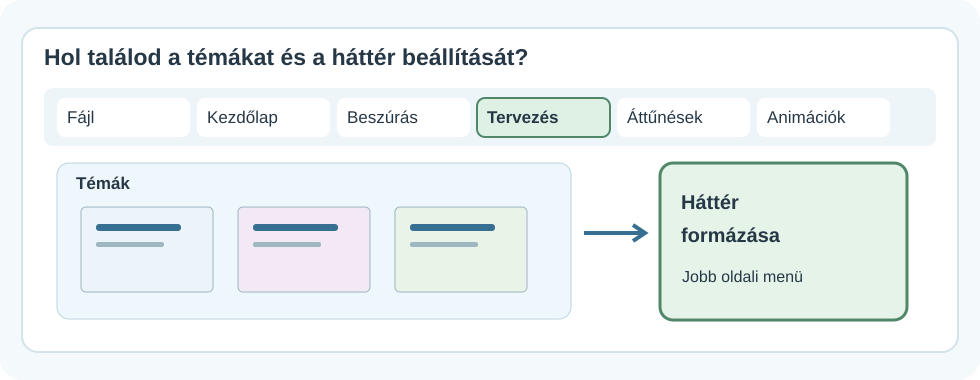
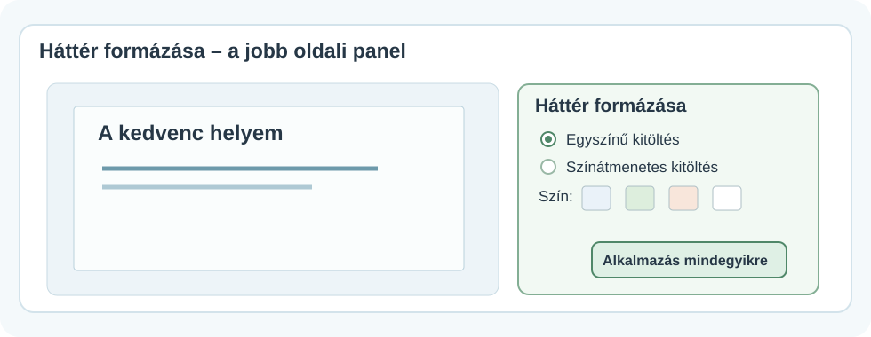
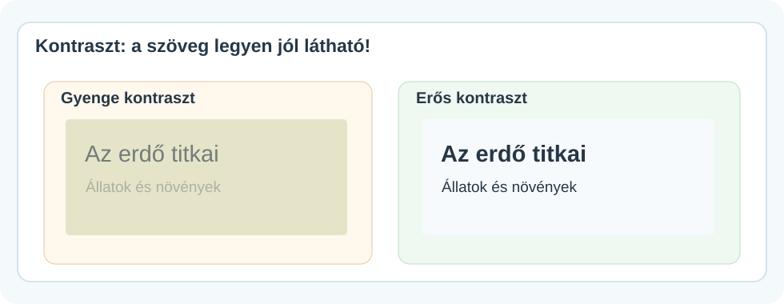
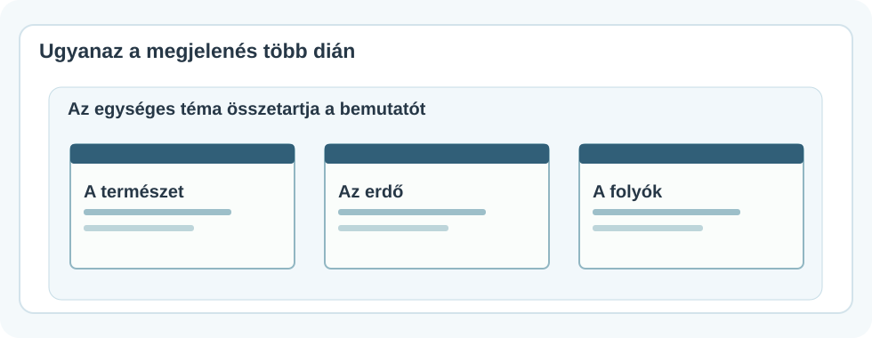

# 🎨 Háttér és egységes megjelenés

DIGITÁLIS ESZKÖZTÁR · POWERPOINT<h2>A háttér segítse a mondanivalódat!</h2>
Válassz egységes témát, állíts be könnyen olvasható hátteret, és ügyelj arra, hogy ne a díszítés vonja el a figyelmet.

🎨

💻 Windowsos PowerPoint🧭 Menütérképek🎨 Szín- és kontrasztpéldák

!!! info "A képes útmutatókról"
    A rajzok **egyszerűsített menütérképek és szemléltető ábrák**, nem szó szerinti képernyőfotók. A pontos gombelhelyezés változhat. A képekre kattintva nagyobb nézet nyílik meg.

## 1. Egy téma az egész bemutatóhoz

A **téma** összeillő betűtípusokat, színeket és megjelenési beállításokat ad a bemutatódnak. Kezdéskor egyszerű, jól olvasható témát válassz!

<figure class="tool-figure tool-figure--wide"><figcaption>A <strong>Tervezés</strong> fülön választhatsz témát. A <strong>Háttér formázása</strong> parancsot általában a menüszalag jobb szélén találod.</figcaption></figure>

1. Kattints a **Tervezés** fülre!
2. Nézd meg a felkínált **Témákat**, és válassz egy letisztult változatot!
3. Ellenőrizd a többi diát is: megmaradt-e a szöveg olvashatósága?

!!! tip "Nem kell minden diának külön díszítés"
    Ha a diák ugyanazt a színvilágot és betűstílust használják, a bemutató rendezettebbnek hat.

## 2. A háttérszín beállítása

Ha csak a háttér színét módosítanád, ezt keresd: **Tervezés → Háttér formázása**.

<figure class="tool-figure tool-figure--wide"><figcaption>A panelen válaszd például az <strong>Egyszínű kitöltés</strong> lehetőséget, majd állítsd be a színt.</figcaption></figure>

1
<strong>Jelöld ki a diát!</strong>A bal oldali listában kattints arra a diára, amelyiknek a hátterét módosítanád.

2
<strong>Tervezés → Háttér formázása</strong>Az ablak jobb oldalán megnyílik a beállítópanel.

3
<strong>Egyszínű kitöltés → Szín</strong>Válassz világos, visszafogott hátteret, és ellenőrizd a szöveget!

!!! warning "Egy diára vagy az összesre?"
    A háttér módosítása rendszerint először a **kijelölt diára** vonatkozik. Ha minden dián azonos hátteret szeretnél, a panel alján keresd az **Alkalmazás mindegyikre** vagy hasonló nevű gombot. Mielőtt rákattintasz, gondold végig, valóban minden diát módosítani akarsz-e!

## 3. Kontraszt – legyen olvasható a szöveg!

A **kontraszt** azt jelenti, mennyire különül el a szöveg a háttértől. Nem az a cél, hogy minél több szín legyen, hanem hogy a néző könnyen el tudja olvasni a diát.

<figure class="tool-figure tool-figure--wide"><figcaption>A jobb oldali változaton a cím és a magyarázat egyértelműen kiemelkedik a háttérből.</figcaption></figure>

- Világos háttérhez általában **sötét szöveg** illik.
- Sötét háttérhez **világos szöveget** válassz.
- Kerüld a nehezen megkülönböztethető színpárokat.
- Ne próbáld pusztán **színnel** jelezni a fontos különbségeket; használj címeket, feliratokat is.

## 4. Egységes bemutató, különböző tartalmak

<figure class="tool-figure tool-figure--wide"><figcaption>A három dia másról szól, de az ismétlődő címsáv és színvilág miatt egy bemutatóhoz tartozik.</figcaption></figure>

A dia tartalma változhat: lehet rajta fotó, ábra vagy felsorolás. A **színvilág**, a címméret és az elrendezés alapelvei viszont maradjanak hasonlók.

!!! info "Mi a helyzet a képes háttérrel?"
    Képet is használhatsz háttérként, de az gyakran megnehezíti az olvasást. Ha képet szeretnél megmutatni, sokszor jobb <a href="../kepek/" target="_blank" rel="noopener">külön képként beszúrni</a>, és mellé helyezni a szöveget.

## 5. Nézd meg diavetítésben!

A saját monitorodon jól látható szöveg a terem hátsó részéből már aprónak vagy halványnak tűnhet. Indítsd el a diavetítést (gyakran az **F5** billentyűvel), és nézd meg teljes képernyőn!

<strong>🎯 Mini feladat</strong>Az előzőleg készített háromdiás bemutatódhoz válassz egy közös témát vagy világos háttérszínt! Ügyelj arra, hogy minden dián jól olvasható legyen a szöveg. Az egyik dián próbálj ki egy másik színt, majd döntsd el, jobb-e az eredetinél!

<strong>✅ Ellenőrizd magad!</strong>
<label><input type="checkbox">Megtaláltam a <strong>Tervezés</strong> fület.</label>
<label><input type="checkbox">Tudom, hogy a <strong>Háttér formázása</strong> panelen választhatok színt.</label>
<label><input type="checkbox">Értem a különbséget egy dia és az összes dia módosítása között.</label>
<label><input type="checkbox">A cím és a szöveg jól elkülönül a háttértől.</label>
<label><input type="checkbox">A diák megjelenése összetartozónak hat.</label>

<a href="../">← Vissza a PowerPoint-eszköztárhoz</a>

