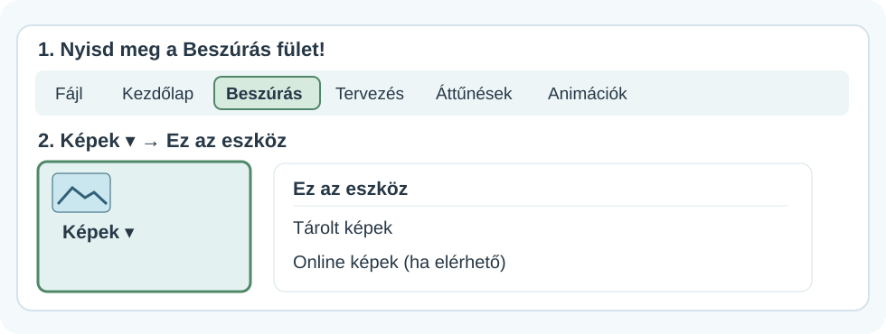
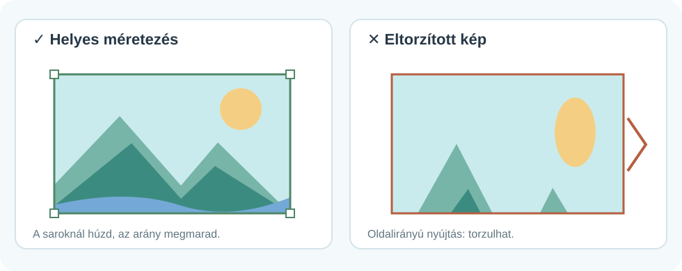
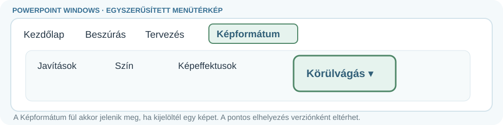
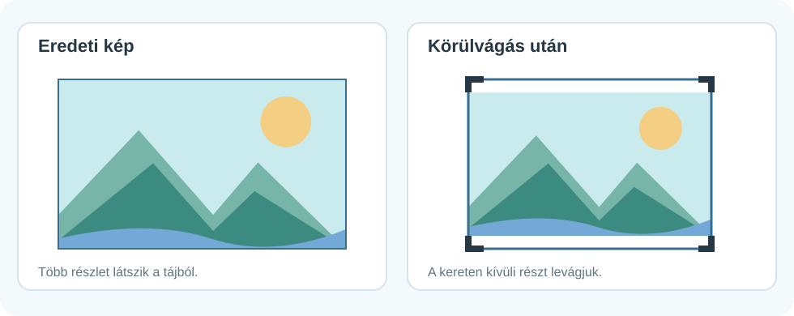
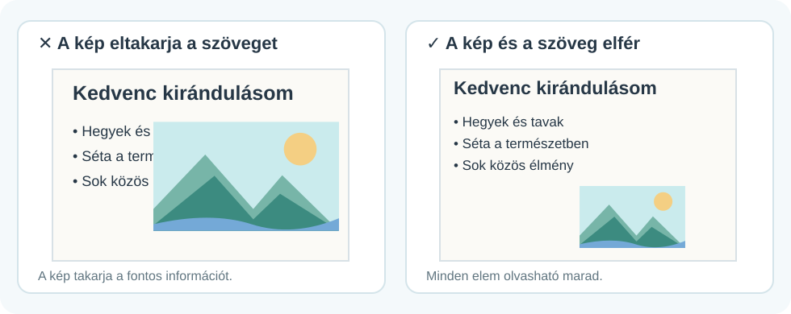

# 🖼️ Képek beszúrása és formázása

DIGITÁLIS ESZKÖZTÁR · POWERPOINT<h2>Jó helyen, jó méretben</h2>
Találd meg a kép beszúrásának helyét, méretezd torzítás nélkül, és rendezd el úgy, hogy a mondanivaló is jól látható maradjon.

🖼️

💻 Windowsos PowerPoint🧭 Menütérképek🔍 Nagyítható magyarázó ábrák

!!! info "Kétféle ábra segít"
    A menütérképek **egyszerűsített szemléltető rajzok, nem képernyőfotók**. A nálatok használt PowerPointban egyes ikonok más helyen lehetnek. A nagyobb ábrák pedig azt mutatják meg, hogy mi történik a képpel.

## 1. Kép beszúrása a saját gépedről

<figure class="tool-figure tool-figure--wide"><figcaption>A képeknél általában ez az útvonal: <strong>Beszúrás → Képek → Ez az eszköz</strong>.</figcaption></figure>

1
<strong>Nyisd meg a megfelelő diát!</strong>Kattints arra a diára, amelyikre a képet szeretnéd.

2
<strong>Beszúrás → Képek → Ez az eszköz</strong>Megnyílik a fájlválasztó ablak. Keresd meg a képfájlt a mappáid között!

3
<strong>Kattints a képre, majd a Beszúrás gombra!</strong>A kép megjelenik a dián, ezután áthelyezheted és méretezheted.

!!! tip "Nem csak a saját gépedről szúrhatsz be képet"
    A PowerPoint változatától és az iskolai beállításoktól függően **Tárolt képek** vagy más képforrás is megjelenhet.

## 2. A kép méretezése – ne torzítsd el!

Kattints a képre: körülötte apró **méretezőfogantyúk** jelennek meg. Ha a **sarkánál** húzod, a képarány jellemzően megmarad. Az oldalsó fogantyúk elhúzása viszont összenyomhatja vagy széthúzhatja a képet.

<figure class="tool-figure tool-figure--wide"><figcaption>A bal oldalon a kép arányos. A jobb oldalon ugyanaz a rajz eltorzult.</figcaption></figure>

!!! warning "Ha a kép már eltorzult"
    Nyomd meg rögtön a **Ctrl+Z** billentyűkombinációt, és próbáld újra a saroknál húzva!

## 3. Körülvágás – csak a szükséges rész maradjon

Előfordul, hogy a képen túl sok minden látszik. Ilyenkor ne nyújtsd szét: használd a **Körülvágás** lehetőséget!

<figure class="tool-figure tool-figure--wide"><figcaption>Előbb jelöld ki a képet! Ekkor jelenik meg a <strong>Képformátum</strong> fül.</figcaption></figure>

1. Jelöld ki a képet.
2. Válaszd a **Képformátum → Körülvágás** parancsot.
3. A megjelenő körülvágójeleket húzd beljebb, hogy a felesleges rész ne látszódjon.
4. Kattints a képen kívülre vagy erősítsd meg a műveletet.

<figure class="tool-figure tool-figure--wide"><figcaption>A körülvágás csak a látható képrészletet változtatja meg: nem kell széthúzni a fotót.</figcaption></figure>

## 4. Helyezd el úgy, hogy ne takarjon semmit!

A kép ne lógjon le a diáról, ne fedje el a címet, és ne zavarja a szöveg olvasását. Nézd meg a két példát!

<figure class="tool-figure tool-figure--wide"><figcaption>A jobb oldali elrendezésben a cím és a szöveg is jól látható marad.</figcaption></figure>

## 5. Milyen képet válassz?

- A kép **kapcsolódjon a mondanivalódhoz**.
- Legyen elég éles, ne legyen apró és homályos.
- Ne használj túl sok képet egyetlen dián.
- Saját fényképet vagy megfelelően felhasználható képet válassz. Képkereséshez jó kiindulópont lehet a [Pixabay](https://pixabay.com/hu/){:target="_blank" rel="noopener"}.

<strong>✅ Ellenőrizd magad!</strong>
<label><input type="checkbox">Megtaláltam a <strong>Beszúrás → Képek</strong> menüt.</label>
<label><input type="checkbox">A képem nincs széthúzva vagy összenyomva.</label>
<label><input type="checkbox">A cím és a szöveg olvasható maradt.</label>
<label><input type="checkbox">A kép valóban segíti a bemutatóm megértését.</label>

<a href="../">← Vissza a PowerPoint-eszköztárhoz</a>

