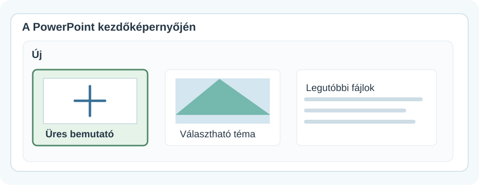
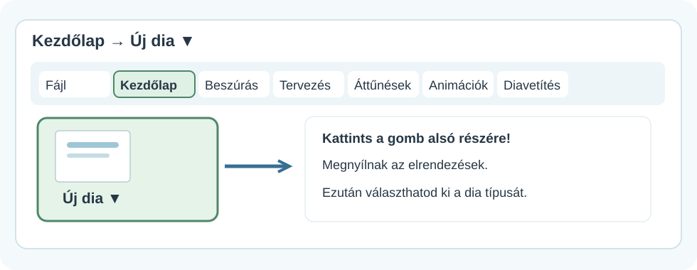
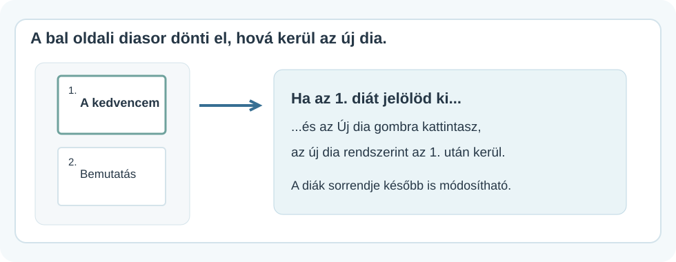
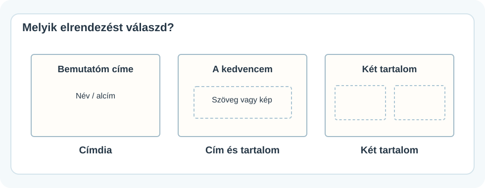

# 🚀 Új bemutató és új dia

DIGITÁLIS ESZKÖZTÁR · POWERPOINT<h2>Indulhat a bemutatód!</h2>
Készíts üres bemutatót, adj hozzá új diát, majd válaszd ki azt az elrendezést, amelyik legjobban illik a mondanivalódhoz.

🚀

💻 Windowsos PowerPoint🧭 Menütérképek🖼️ Diaelrendezési példák

!!! info "Hogyan olvasd az ábrákat?"
    A képek **egyszerűsített menütérképek és szemléltető ábrák**, nem szó szerinti PowerPoint-képernyőfotók. A gombok elhelyezkedése a program változatától és az ablak szélességétől kissé eltérhet. A képekre kattintva nagyobb méretben is megnézheted őket.

## 1. Új, üres bemutató indítása

<figure class="tool-figure tool-figure--wide"><figcaption>A PowerPoint kezdőképernyőjén keresd az <strong>Üres bemutató</strong> lehetőséget.</figcaption></figure>

1. Nyisd meg a **PowerPointot**!
2. Válaszd az **Üres bemutató** lehetőséget. Ha már egy bemutatóban vagy, válaszd a **Fájl → Új** menüt!
3. A megjelenő címdián kattints a **Cím** mezőbe, és írd be a bemutatód címét.
4. Az **Alcím** mezőbe írhatod például a nevedet.

!!! tip "Először tervezd meg!"
    Gondold végig, miről szólnak majd a diáid. Egy jó bemutatóban minden diának van feladata: cím, bemutatás, részletek, lezárás.

## 2. Új dia hozzáadása

<figure class="tool-figure tool-figure--wide"><figcaption>Ezt keresd: <strong>Kezdőlap → Új dia</strong>. A gomb alsó részén található nyíllal az elrendezésekből is választhatsz.</figcaption></figure>

1
<strong>Válaszd ki a helyét!</strong>A bal oldali diasorban jelöld ki azt a diát, amely után új diát szeretnél.

2
<strong>Kezdőlap → Új dia</strong>Új dia jön létre. Ha a nyilat választod, előbb kiválaszthatod az elrendezést is.

3
<strong>Töltsd meg tartalommal!</strong>Kattints a cím- vagy tartalommezőkbe, és írj vagy szúrj be megfelelő elemeket.

<figure class="tool-figure tool-figure--wide"><figcaption>Ha az első dia után szeretnél újat, előbb az első diát jelöld ki a bal oldali listában.</figcaption></figure>

!!! info "Új dia ≠ új bemutató"
    Az **Új dia** ugyanabba a bemutatóba tesz új oldalt. Az **Új bemutató** viszont egy másik, különálló munkát indít.

## 3. Diaelrendezés – mire való?

A diaelrendezés azt határozza meg, milyen helyőrzők jelennek meg a dián. Nem kell minden diának ugyanolyannak lennie.

<figure class="tool-figure tool-figure--wide"><figcaption>A címdiára a bemutató neve kerül; a tartalmi diákra magyarázat, kép, felsorolás vagy más információ.</figcaption></figure>

- **Címdia:** a bemutató neve és a készítő neve.
- **Cím és tartalom:** a legtöbb magyarázó diához jó választás.
- **Két tartalom:** két képet vagy két gondolatot hasonlíthatsz össze.

Ha egy meglévő dia elrendezését változtatnád meg, jelöld ki a diát, majd keresd a **Kezdőlap → Elrendezés** lehetőséget. A menü neve egyes telepített változatokban **Diaelrendezés** lehet.

## 4. Próbáld ki önállóan!

<strong>🎯 Mini feladat</strong>Készíts egy háromdiás bemutatót a kedvenc állatodról vagy helyedről! Az első legyen címdia; a másodikon legyen cím és tartalom; a harmadikon próbáld ki a két tartalom elrendezést.

<strong>✅ Ellenőrizd magad!</strong>
<label><input type="checkbox">Elindítottam egy üres bemutatót.</label>
<label><input type="checkbox">Megtaláltam a <strong>Kezdőlap → Új dia</strong> parancsot.</label>
<label><input type="checkbox">Tudom, mire való az <strong>Elrendezés</strong> menü.</label>
<label><input type="checkbox">Három diám van, és mindegyik más szerepet kapott.</label>

<a href="../">← Vissza a PowerPoint-eszköztárhoz</a>

