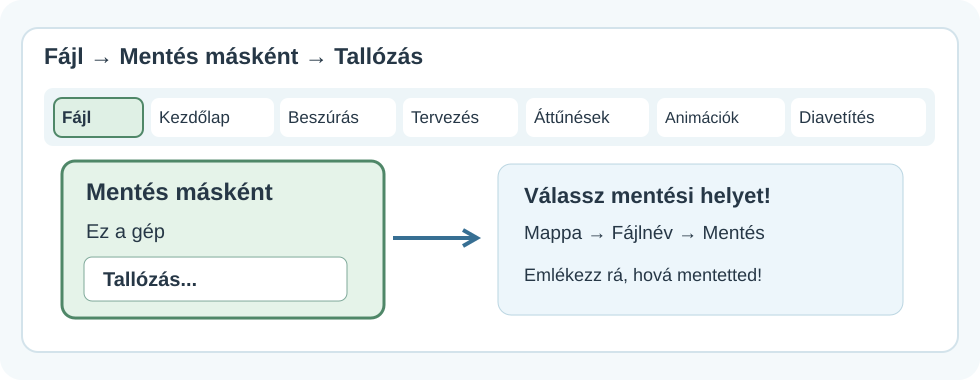
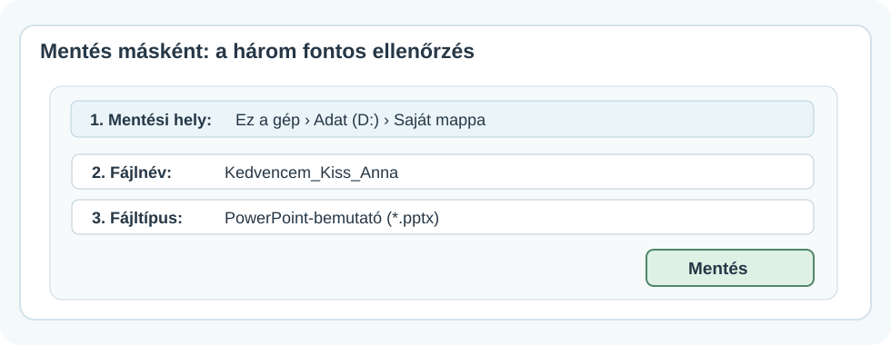
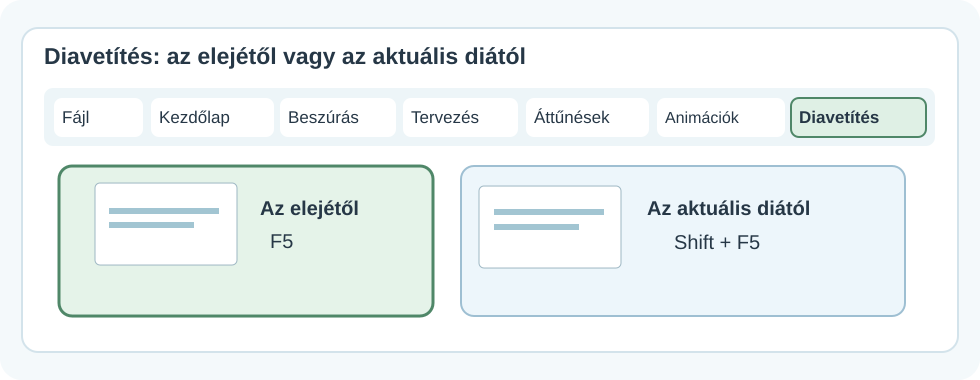
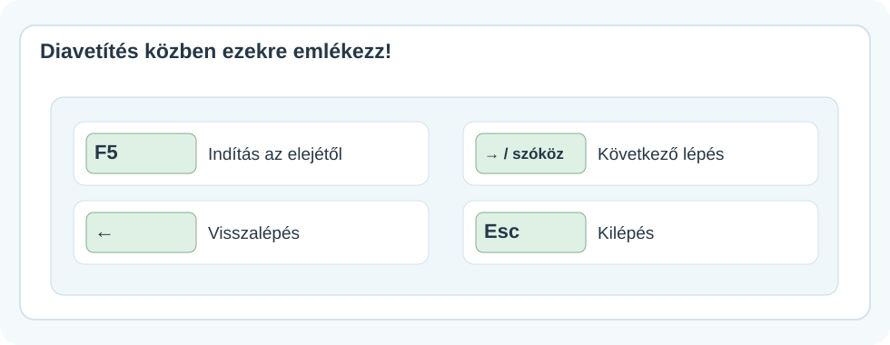

# 💾 Mentés, diavetítés és fájlbeadás

DIGITÁLIS ESZKÖZTÁR · POWERPOINT<h2>Kész a bemutatód? Tedd biztonságba és próbáld ki!</h2>
Akkor vagy kész, ha a fájlt meg is találod, diavetítésben végignézted, és a megfelelő munkát tudod beadni.

💾

💻 Windowsos PowerPoint🧭 Menütérképek⌨️ Gyorsbillentyűk

!!! info "Hogyan használd az ábrákat?"
    A képek **egyszerűsített szemléltető menütérképek**, nem pontos képernyőfotók. A gombok helye a telepített PowerPoint változatától és az ablak méretétől kicsit eltérhet. Kattints a képekre a nagyobb nézethez!

## 1. Ne veszítsd el a munkádat – mentsd el!

Az első mentésnél három dolgot érdemes tudatosan megadnod: **a mappát, a fájlnevet és a fájltípust**.

<figure class="tool-figure tool-figure--wide"><figcaption>Ezt keresd: <strong>Fájl → Mentés másként</strong>, majd szükség esetén <strong>Ez a gép → Tallózás</strong>.</figcaption></figure>

1
<strong>Nyisd meg a mentést!</strong>Válaszd a Fájl → Mentés másként lehetőséget. Az első mentésnél a Ctrl+S is segíthet a mentési ablak megnyitásában.

2
<strong>Válaszd ki a megfelelő mappát!</strong>Az iskolában oda ments, ahová a tanár kéri. A meghajtó betűjele gépenként eltérhet.

3
<strong>Adj beszédes fájlnevet!</strong>Például: Kedvencem_Kiss_Anna. A nevedből és a feladatból később is felismerhető legyen a munkád!

4
<strong>Ellenőrizd a fájltípust, majd ments!</strong>A szokásos szerkeszthető PowerPoint-fájl kiterjesztése .pptx.

<figure class="tool-figure tool-figure--wide"><figcaption>A lényeg nem a Mentés gomb gyors megnyomása, hanem hogy tudd: <strong>hová</strong>, <strong>milyen néven</strong> és <strong>milyen formátumban</strong> mentettél.</figcaption></figure>

!!! warning "Ne csak a fájlnévre figyelj!"
    Hiába nevezed el jól a bemutatót, ha utána nem találod meg. Mentés előtt nézd meg a <strong>mappa útvonalát</strong> is! A képen látható meghajtó és név csak példa.

## 2. Munka közben is ments!

Ha a bemutatód már megkapta a helyét és a nevét, a **Ctrl+S** billentyűkombinációval rendszeresen mentheted a módosításaidat.

- Ments egy-egy hosszabb munkarész után!
- Ha más néven vagy másik mappába szeretnél egy új példányt, használd a **Mentés másként** lehetőséget!
- A **.pptx** szerkeszthető bemutató. A **.pdf** más célra való: általában nem használható a diák és animációk PowerPoint-szerkesztésére.

## 3. Próbáld ki diavetítésben!

A szerkesztőnézetben látod a menüket és a diák kicsinyített képeit. A **diavetítés** viszont megmutatja, mit lát majd a közönség.

<figure class="tool-figure tool-figure--wide"><figcaption>A <strong>Diavetítés</strong> fülön választhatsz, honnan induljon a bemutató. Gyorsbillentyűvel is működik.</figcaption></figure>

- **F5:** a bemutató indítása az első diától.
- **Shift+F5:** indítás a jelenleg kijelölt diától.

!!! tip "Az F5 és a fényerőgomb"
    Egyes laptopokon az F5 funkcióhoz az **Fn** billentyűt is le kell nyomni. Ha nem indul, használd a Diavetítés menüt!

## 4. Így vezéreld vetítés közben

<figure class="tool-figure tool-figure--wide"><figcaption>A <strong>jobbra nyíl</strong> vagy <strong>szóköz</strong> a következő animációs lépésre vagy diára léptet; az <strong>Esc</strong> kilép a vetítésből.</figcaption></figure>

| Mit szeretnél? | Billentyű |
|---|---|
| Vetítés indítása az elejétől | **F5** |
| Indítás az aktuális diától | **Shift+F5** |
| Következő lépés vagy dia | **→**, **szóköz** |
| Előző lépés vagy dia | **←** |
| Visszatérés a szerkesztéshez | **Esc** |

!!! info "Miért nem lépett rögtön a következő diára?"
    Ha az aktuális dián **animációk** vannak, egy kattintás vagy billentyűnyomás először a következő animációt indíthatja el. Csak utána következik a következő dia. Erről az <a href="../animaciok-attunesek/" target="_blank" rel="noopener">Animációk és áttűnések</a> útmutatóban olvashatsz.

## 5. Ellenőrizd az egészet, mielőtt beadod!

Vetítés közben nézd meg:

1. A diák **helyes sorrendben** következnek-e.
2. A képek és szövegek **nem lógnak-e le** és nem takarják-e egymást.
3. A címek és feliratok **távolabbról is olvashatók-e**.
4. Az animációk és áttűnések **érthető sorrendben** jelennek-e meg.
5. Találsz-e elírást vagy hibásan elhelyezett elemet.

## 6. Moodle-beadás: a megfelelő fájlt töltsd fel!

Ha a feladatban a tanárod **PowerPoint-bemutatót (.pptx)** kér, ezt a fájlt keresd meg és töltsd fel a Moodle-feladatba!

!!! warning "Nem minden fájl ugyanaz"
    - A **.pptx** a szerkeszthető PowerPoint-bemutató.
    - A **.pdf** megjelenítésre alkalmas, de az animációk és szerkeszthető elemek nem úgy működnek benne.
    - Egy **megosztási link** nem helyettesíti a fájlfeltöltést, ha a feladat kifejezetten fájlt kér.

    Mindig a feladat pontos beadási feltételeit kövesd!

<strong>🎯 Mini feladat</strong>Nyisd meg az eddig készített bemutatódat! Mentsd a kijelölt mappába beszédes névvel, nézd végig F5-tel, javítsd az esetleges hibákat, majd Ctrl+S-sel mentsd ismét. Végül a Fájlkezelőben is keresd meg a kész .pptx fájlt!

<strong>✅ Ellenőrizd magad!</strong>
<label><input type="checkbox">Tudom, melyik mappában van a munkám.</label>
<label><input type="checkbox">A fájlnévből felismerhető a feladat és a készítő.</label>
<label><input type="checkbox">A bemutatóm <strong>.pptx</strong> formátumban van elmentve.</label>
<label><input type="checkbox">Végignéztem diavetítésben és kijavítottam a hibákat.</label>
<label><input type="checkbox">A kész fájlt meg tudom találni és szükség esetén feltölteni.</label>

<a href="../">← Vissza a PowerPoint-eszköztárhoz</a>

