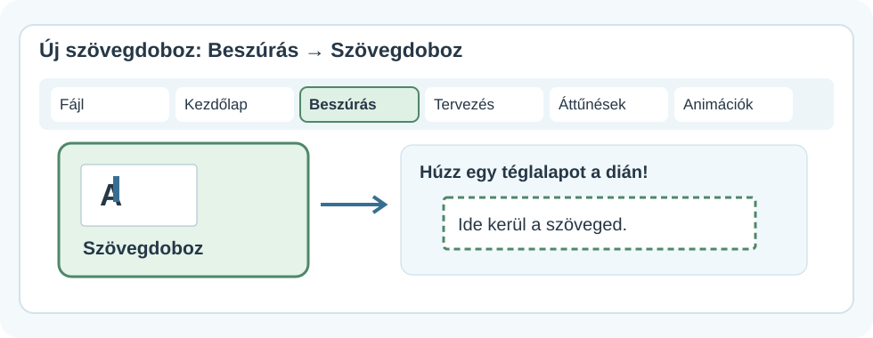
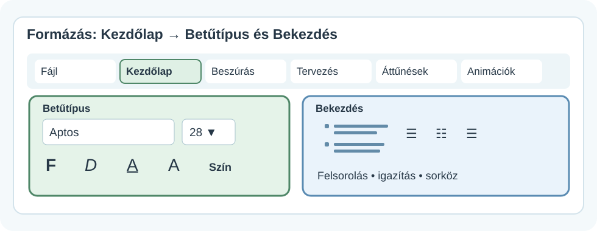
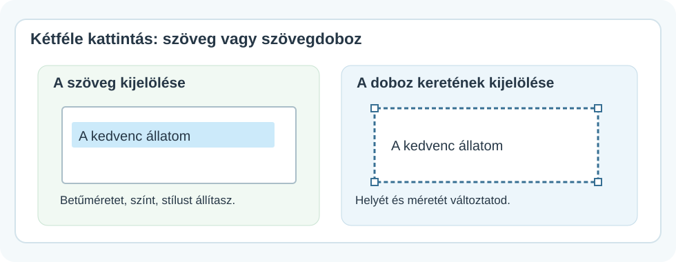
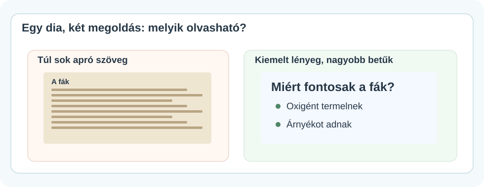

# 🔠 Szöveg és cím formázása

DIGITÁLIS ESZKÖZTÁR · POWERPOINT<h2>A szöveged legyen jól olvasható!</h2>
Írj a megfelelő helyre, találd meg a formázóeszközöket, és emeld ki azt, amit a közönségednek meg kell jegyeznie.

🔠

💻 Windowsos PowerPoint🧭 Menüábrák✍️ Gyakorlati lépések

!!! info "Mit mutatnak a képek?"
    Ezek **egyszerűsített menütérképek és szemléltető ábrák**, nem pontos képernyőfotók. A gombok elhelyezkedése a PowerPoint változatától és az ablak szélességétől kicsit eltérhet. A képekre kattintva nagyobb méretben is megnézheted őket.

## 1. Szöveg írása a diára

Ha a dián már van **Kattintson ide a cím beírásához** vagy más szöveghely, kattints oda, és kezdj írni. Ezt **helyőrzőnek** nevezzük.

Ha máshol szeretnél szöveget elhelyezni, készíts külön szövegdobozt!

<figure class="tool-figure tool-figure--wide"><figcaption>Ezt keresd: <strong>Beszúrás → Szövegdoboz</strong>. Utána az egérrel rajzold meg a doboz helyét a dián.</figcaption></figure>

1
<strong>Beszúrás → Szövegdoboz</strong>Válaszd ki a Szövegdoboz parancsot.

2
<strong>Húzz egy keretet!</strong>Nyomd le az egérgombot a dián, és húzd meg a doboz területét.

3
<strong>Írj bele!</strong>Gépeld be a szöveget. Ha elkészültél, kattints a dobozon kívülre.

!!! tip "Melyiket válaszd?"
    A dia **címéhez** legjobb a diaelrendezésben megjelenő címhelyőrzőt használni. Külön **Szövegdoboz** akkor kell, ha máshová is szeretnél feliratot tenni.

## 2. Betűméret, betűszín, betűstílus

<figure class="tool-figure tool-figure--wide"><figcaption>A <strong>Kezdőlap</strong> fülön egymás közelében találod a <strong>Betűtípus</strong> és <strong>Bekezdés</strong> eszközeit.</figcaption></figure>

1. Jelöld ki azt a szöveget, amelynek a külsejét megváltoztatnád!
2. Kattints a **Kezdőlap** fülre!
3. A **Betűtípus** résznél állítsd a méretet, a színt vagy a betűstílust!
4. Ha csak néhány szó fontos, elég **azokat** félkövérré tenned.

| Eszköz | Mire való? |
|---|---|
| **Betűméret** | Nagyobb vagy kisebb betűk |
| **Félkövér (F)** | Egy fontos szó vagy cím kiemelése |
| **Dőlt (D)** | Visszafogott hangsúlyozás |
| **Betűszín** | Jól látható kontraszt kialakítása |

!!! warning "Ne díszíts túl sokat!"
    Ha minden színes, félkövér és aláhúzott, semmi sem lesz igazán hangsúlyos. Egy dián legyen egyértelmű, **mit nézzen meg először** a közönséged.

## 3. Szöveg kijelölése vagy a doboz mozgatása?

Ez a két művelet nagyon hasonlónak látszik, de más történik!

<figure class="tool-figure tool-figure--wide"><figcaption>Ha a <strong>betűket</strong> jelölöd ki, formázhatod a szöveget. Ha a <strong>doboz szélét</strong> fogod meg, az egész szövegdobozt mozgathatod.</figcaption></figure>

- **A szöveg formázásához:** kattints a dobozba, majd húzással jelöld ki a betűket.
- **A szövegdoboz áthelyezéséhez:** kattints a doboz keretére, és annál fogva húzd új helyre.
- **A doboz méretezéséhez:** a kijelölt doboz szélein megjelenő fogantyúkat húzd.

!!! info "Ha nem azt módosítottad, amit szerettél volna"
    Nyomd meg a **Ctrl+Z** billentyűkombinációt, majd ellenőrizd, hogy a szöveget vagy a szövegdoboz keretét jelölted-e ki.

## 4. Felsorolás és szövegigazítás

A hosszú bekezdések helyett sokszor jobb a **rövid felsorolás**.

1. Jelöld ki a felsorolássá alakítandó sorokat!
2. Nyisd meg a **Kezdőlap → Bekezdés** részt!
3. Válaszd a **Felsorolás** (pontok) vagy **Számozás** lehetőséget!
4. Ugyanitt találod a **balra**, **középre** és **jobbra igazítást** is.

!!! tip "A cím és a felsorolás nem ugyanaz"
    A címet gyakran középre igazítjuk. A több sorból álló magyarázó szöveg vagy felsorolás általában **balra igazítva** olvasható a legkönnyebben.

## 5. Egy jó dia nem olvasókönyv

<figure class="tool-figure tool-figure--wide"><figcaption>A jobb oldali dián a lényeg már távolabbról is könnyebben felismerhető.</figcaption></figure>

- Használj **rövid kifejezéseket és kulcsszavakat**.
- A címed legyen **jól láthatóan nagyobb**, mint a magyarázó szöveg.
- Ne zsúfold tele a diát: a részleteket **szóban is elmondhatod**.
- A betűszín és a háttér különüljön el egymástól.
- Lehetőleg **egy-két betűtípust** használj az egész bemutatóban.

<strong>🎯 Mini feladat</strong>Készíts egy diát „A kedvenc helyem” címmel! Írj három rövid gondolatot felsorolásként, és helyezz el egy külön szövegdobozt „Miért szeretem?” felirattal. A címet emeld ki, a többi szöveget tartsd olvashatónak!

<strong>✅ Ellenőrizd magad!</strong>
<label><input type="checkbox">Használtam címhelyőrzőt vagy szövegdobozt.</label>
<label><input type="checkbox">Megtaláltam a <strong>Kezdőlap → Betűtípus</strong> eszközeit.</label>
<label><input type="checkbox">El tudom mozdítani a szövegdobozt a kereténél fogva.</label>
<label><input type="checkbox">A diám nem zsúfolt, és a szöveg jól olvasható.</label>

<a href="../">← Vissza a PowerPoint-eszköztárhoz</a>

