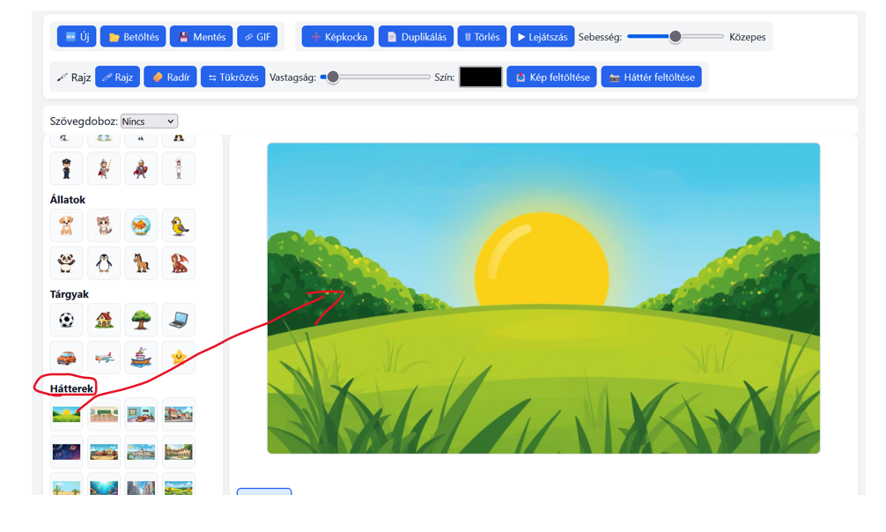
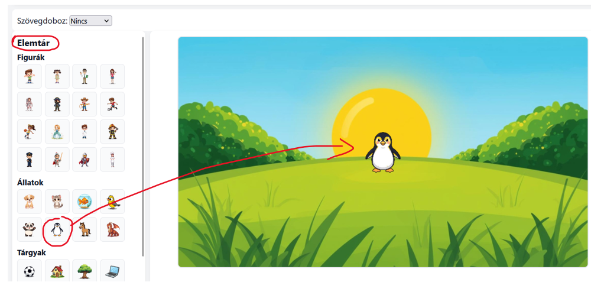
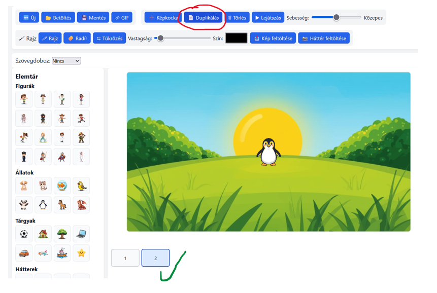
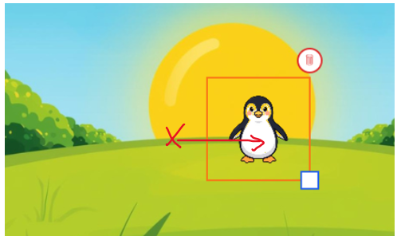
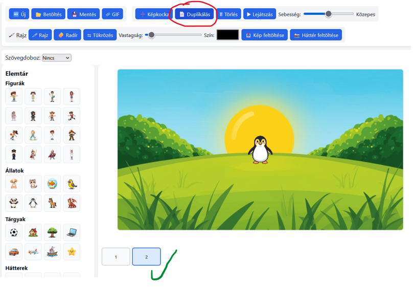
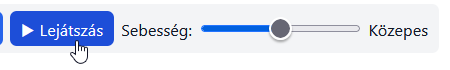

# 🎾 Próbáld ki! – Mozduljon meg!

<strong>ANIMÁCIÓ · 2. ÁLLOMÁS / 6</strong> Irányított, egyéni feladat. Itt még mindenki saját maga próbálja ki a programot.

## 🎯 A feladat

**Küldetés:** készíts rövid animációt, amelyben **egy szereplő** a kép egyik oldaláról a másikra halad! Válassz hozzá **egy hátteret**, és készíts **legalább 6 képkockát**!

{ target="_blank" rel="noopener" }

[🎬 Nyisd meg a Mini Animációs Stúdiót!](https://interaktivfeladat.hu/jatek/animacio/){ .md-button .md-button--primary target="_blank" rel="noopener" }

## 🧩 Így készül a mozgás – hat lépésben

Haladj sorban! A képek a Mini Animációs Stúdió eredeti kezelőfelületét mutatják.

???+ example "1. Készíts új projektet!"

    Kattints az **Új** gombra, és válassz egy egyszerű hátteret!

    {: target="_blank" rel="noopener noreferrer" }

??? example "2. Helyezz el egy szereplőt!"

    Válassz egy figurát az **Elemtárból**, és helyezd a kép bal oldalára! Hagyj neki helyet a mozgáshoz.

    {: target="_blank" rel="noopener noreferrer" }

??? example "3. Duplikáld a képkockát!"

    Kattints a **Duplikálás** gombra! Így az új képkockán az előző kép minden eleme a helyén marad.

    {: target="_blank" rel="noopener noreferrer" }

??? example "4. Mozdítsd el egy kicsit!"

    A második képkockán húzd a szereplőt kissé jobbra! Figyeld meg a két képkocka közötti kis változást.

    {: target="_blank" rel="noopener noreferrer" }

??? example "5. Ismételd meg!"

    Duplikáld újra a képkockát, és mozdítsd tovább a szereplőt! Legyen **legalább 6 képkockád**.

    {: target="_blank" rel="noopener noreferrer" }

??? example "6. Játszd le!"

    Indítsd el az animációt! Nézd meg **kétféle sebességgel**! Ha ugrál a mozgás, módosítsd az elmozdításokat, és játszd le újra!

    {: target="_blank" rel="noopener noreferrer" }

<h2 style="margin:0 0 12px;color:#70449f;font-size:23px">👀 Ilyen legyen a mozgás!</h2>

A szereplő minden új képkockán csak egy kicsivel kerül távolabb.

<h2 style="margin:0 0 9px;color:#ad6800;font-size:23px">🔬 Kísérletezz!</h2>
Próbáld ki ugyanazt az animációt többféleképpen!

<strong style="color:#a76000">🐢 Lassítsd le!</strong>
Mit tapasztalsz, ha lassabbra állítod a lejátszást?

<strong style="color:#a76000">🚀 Gyorsítsd fel!</strong>
Mennyiben változik a mozgás, ha gyorsabban játszod le?

<strong style="color:#a76000">🦘 Készíts nagy ugrást!</strong>
Mozdítsd el egyszer túl nagy távolságra! Mit látsz?

<h2 style="margin:0 0 6px;color:#287747;font-size:23px">⭐ Mini kihívás</h2>
Ha elkészültél, folytasd az animációt úgy, hogy a szereplő <strong>megforduljon és visszafelé induljon</strong>!

!!! tip "💬 Kísérletezz a feliratokkal is!"
    A Szövegdoboz menüben próbáld ki a **Felső sáv**, **Alsó sáv** és **Mindkettő** lehetőséget! Elég egy rövid szó vagy mondat.

[💬 Felirat készítése – Szövegdoboz](https://bsuszter.github.io/digitalis-eszkoztar/eszkoztar/mini-animacios-studio/feliratok/){ target="_blank" rel="noopener" } · [🧰 Saját képek és hátterek](https://bsuszter.github.io/digitalis-eszkoztar/eszkoztar/mini-animacios-studio/elemek-rajz/){ target="_blank" rel="noopener" } · [🧰 Képkocka és duplikálás](https://bsuszter.github.io/digitalis-eszkoztar/eszkoztar/mini-animacios-studio/kepkockak/){ target="_blank" rel="noopener" } · [🧰 Lejátszás és sebesség](https://bsuszter.github.io/digitalis-eszkoztar/eszkoztar/mini-animacios-studio/lejatszas-mentes/){ target="_blank" rel="noopener" }

!!! warning "Fontos különbség"
    A **Képkocka** üres képet kezd; a **Duplikálás** az előző képet másolja, ezért mozgás készítésénél többnyire ezt használd.

## ✅ Készen vagy, ha…

- [ ] Van legalább 6 képkockám.
- [ ] Ugyanaz a szereplő látható minden képkockán.
- [ ] A szereplőt fokozatosan mozdítottam el.
- [ ] Lejátszottam és ellenőriztem az animációt.

---

[← Előző](../01-fedezd-fel/){ .md-button } [Következő →](../03-tervezd-meg/){ .md-button .md-button--primary } [🏠 Áttekintés](../){ .md-button }
