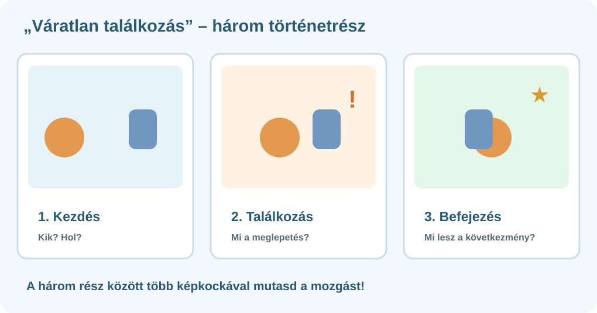

# 📝 Tervezd meg! – Váratlan találkozás

<strong>ANIMÁCIÓ · 3. ÁLLOMÁS / 6</strong> Találd ki a két szereplő találkozásának történetét! Előbb tervezz, utána nyisd meg a szerkesztőt.

## 🎯 A történet

**Két szereplő váratlanul találkozik.** Legyen érthető a **kezdőhelyzet**, történjen egy **meglepő fordulat**, és legyen **lezárás**.

{ target="_blank" rel="noopener" }

## 1. Válassz munkaformát!

- **Egyénileg:** te tervezed és készíted a teljes animációt.
- **Párban:** közösen terveztek egy filmet. A **Rendező** figyeli a történetet, az **Animátor** kezeli a programot. **Félidőben kötelező szerepet cserélni**, hogy mindketten alkossatok.

Azonosak a szakmai elvárások és az elérhető pontszámok.

## 2. Készíts rövid jelenettervet!

| Kérdés | Tervem / tervünk |
| --- | --- |
| Kik a két szereplő? | … |
| Hol játszódik? | … |
| Hogyan közelednek egymáshoz? | … |
| Mi a váratlan fordulat? | … |
| Hogyan zárul a történet? | … |

Rajzold le vázlatosan az **első**, a **találkozási** és az **utolsó** képkockát!

!!! info "A majdani film keretei"
    Legalább **10 képkocka**, **2 szereplő**, követhető mozgás, váratlan de érthető fordulat és lezárás. Legfeljebb **2 rövid szöveg** kerülhet bele.

## ✅ Készen vagy, ha…

- [ ] Döntöttem az egyéni vagy páros munkáról.
- [ ] Két szereplővel megterveztem a történetet.
- [ ] Megvan három kulcsképkockám.
- [ ] Páros munka esetén megállapodtunk a szerepekben és a szerepcserében.

---

[← Előző](../02-probald-ki/){ .md-button } [Következő →](../04-keszitsd-el/){ .md-button .md-button--primary } [🏠 Áttekintés](../){ .md-button }
