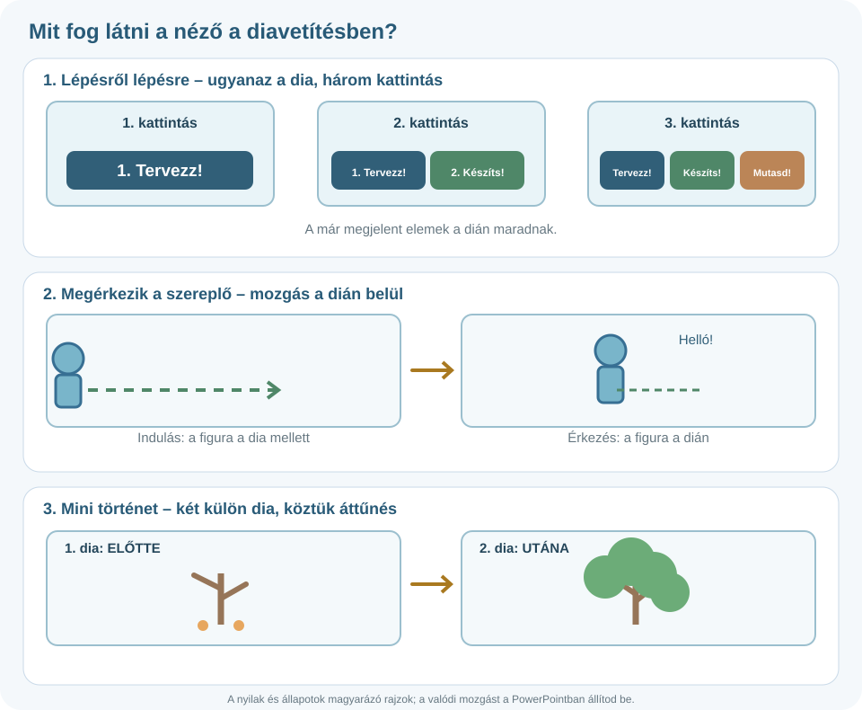

# ✨ Animációk – keltsd életre a diákat!

  <strong>Bemutatókészítés · 3. alkotóműhely</strong>
  Az animáció nem puszta látványosság: segíthet a figyelem irányításában és a történet elmesélésében.

## Animáció és áttűnés – mi a különbség?

| Animáció | Áttűnés |
| --- | --- |
| Egy dián belül mozgat vagy jelenít meg **egy elemet**. | **Két dia közötti** váltást szabályozza. |
| Például a cím fokozatos megjelenése. | Például az egyik dia halványan átúszik a következőbe. |
| Menüpont: **Animációk** | Menüpont: **Áttűnések** |

## 1. Próbáld ki az animációt!

[🧰 Segítség: animációk és áttűnések](../../../../eszkoztar/powerpoint/animaciok-attunesek.md){ target="_blank" rel="noopener" }

Szúrj be egy alakzatot. Jelöld ki, majd az **Animációk** menüben válassz egyszerű megjelenési effektust. Indítsd el a diavetítést, és figyeld meg, mikor jelenik meg az elem.

Nézd meg az indítás lehetőségeit: **kattintásra**, **az előzővel együtt**, **az előző után**. A menüpontok neve és kínálata eltérhet a PowerPoint verziójától.

## 2. Miért pont úgy mozog?

Gondold végig: a közönségnek előbb a címre, majd a képre kell figyelnie? Ebben az esetben érdemes ezeket **egymás után** megjeleníteni. Ha több elem egyszerre mozog, könnyen zavaró lesz.

## 3. Mozgásvonalak

Az asztali PowerPointban egyes objektumokat előre megrajzolt útvonal mentén is mozgathatsz. Ha a webes változatban ez a lehetőség hiányzik, válassz más animációt, és az üzenet érthetőségére figyelj.

## 🎬 Három kreatív kihívás

1. **Lépésről lépésre:** készíts diát egy háromlépéses folyamatról. A három elem egymás után jelenjen meg!
2. **Megérkezik a szereplő:** helyezz el egy saját alakzatfigurát, amely egy mozgással belép a képbe!
3. **Mini történet:** legalább két dián mutass be rövid változást: *előtte → utána*. Használj hozzá egy visszafogott áttűnést!

### Nézd meg, pontosan milyen eredményt készíts!

{ target="_blank" rel="noopener" }

*A képre kattintva nagyobb méretben is megnézheted. A rajz egymás utáni **állapotokat** mutat, nem lejátszható animáció.*

- **1. dia – Lépésről lépésre:** írd ki a **Tervezz! → Készíts! → Mutasd be!** lépéseket három külön szövegdobozba. Vetítéskor az első kattintásra csak az első jelenjen meg, a másodikra a második, a harmadikra a harmadik. A korábbiak maradjanak láthatók.
- **2. dia – Megérkezik a szereplő:** állíts össze egyszerű figurát alakzatokból. A figura például **balról ússzon be** a dia közepére, vagy haladjon **mozgásvonalon**. A célpontot te találhatod ki.
- **3–4. dia – Előtte és utána:** az egyik dián legyen például egy **kopár fa**, a következőn ugyanaz **lombosan**. A két dia közé állíts be látványos, de követhető **áttűnést** (például Tolás vagy Törlés).

**A beadandó tehát egyetlen, legalább négy diából álló PowerPoint-fájl.** A bemutatót diavetítés módban is próbáld ki: a nézőnek a mozgásból értenie kell, mi történik.

!!! tip "Próbavetítés"
    Minden effektus után indítsd el a diavetítést, mert szerkesztőnézetben nem mindig látszik, hogy mit fog érzékelni a néző.

## ✅ Ellenőrzőlista

- [ ] Tudom, mikor használok animációt és mikor áttűnést.
- [ ] Nem vonja el a mozgás a figyelmet a mondanivalóról.
- [ ] Megnéztem a lejátszási sorrendet és a sebességet.
- [ ] Mindhárom kihívást elkészítettem egy, legalább négy diából álló bemutatóban.
- [ ] A fájlt elmentettem és a megfelelő feladathoz adom be.

[← Vissza a Bemutatókészítés fejezethez](../){ .md-button }
