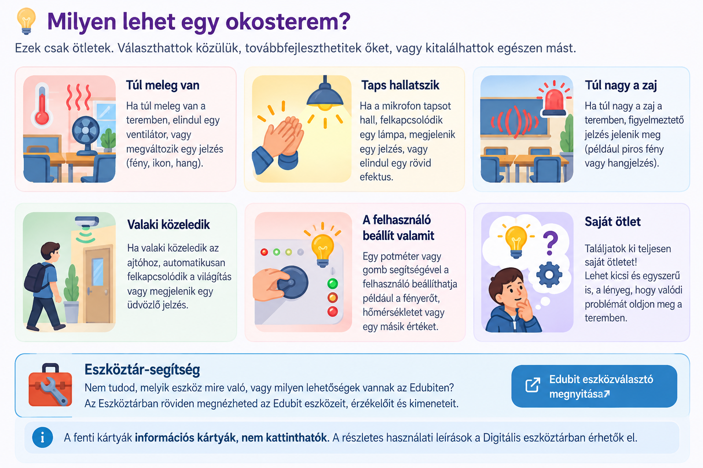

  

    OKOSTEREM · 1. MÉRFÖLDKŐ
    <h2>🏫 Találd ki az okostermedet!</h2>
    
Először ne programozzatok! Találjátok ki, milyen problémát oldjon meg a rendszeretek.

  

  
🏫

  👥 Páros munka
  🧭 1 / 6 mérföldkő
  ⭐ 5 pont
  ⏱️ kb. 1 tanóra

  <h2>🎯 A kihívás</h2>
  
Tervezzetek egy olyan <strong>okostermi rendszert</strong>, amely érzékel valamit, dönt a helyzetről, majd valamilyen módon reagál!

  
👀 ÉRZÉKELÉS → 🧠 DÖNTÉS → ⚙️ REAKCIÓ

  <h2>🌱 Nem kell bonyolultnak lennie!</h2>
  
Nem az a cél, hogy minél több eszközt használjatok. Egy <strong>egyszerű, jól átgondolt és később működő rendszer</strong> teljes értékű megoldás.

  
Most még csak az ötletet tervezzük. A programozás és az építés később következik.

<figure class="tool-figure tool-figure--wide">
  
</figure>

## 📝 Készítsétek el az első tervet!

Beszéljétek meg a párotokkal az ötletet, majd a beadási felületen röviden válaszoljatok az alábbi kérdésekre!

  
<strong>1. Milyen problémát szeretnétek megoldani az okosteremben?</strong>Írjátok le röviden, mire lenne jó a rendszeretek!

  
<strong>2. Mit kell ehhez érzékelnie vagy észlelnie?</strong>Például hőmérsékletet, hangot, gombnyomást, közelséget vagy valamilyen beállított értéket.

  
<strong>3. Mikor és hogyan reagáljon?</strong>Gondoljatok legalább két különböző helyzetre vagy állapotra!

  
<strong>4. Mit tapasztaljon ebből az ember?</strong>Lásson fényt? Halljon hangot? Mozduljon meg valami? Kapcsolódjon be egy eszköz?

  
<strong>5. Milyen eszközökre lehet szükségetek? Miért?</strong>Ez még csak első ötlet. Nem baj, ha később változtattok rajta.

## 🧰 Miből építhetitek meg?

Még nem kell tudnotok használni az összes Edubit-eszközt. Most csak azt gondoljátok végig, <strong>mi segíthetne az ötletetek megvalósításában</strong>.

  
🚦 <strong>LED</strong>állapotjelzés

  
🌈 <strong>RGB LED</strong>színes visszajelzés

  
🎚️ <strong>Potméter</strong>érték beállítása

  
🔘 <strong>Nyomógomb</strong>felhasználói jel

  
⚙️ <strong>Szervó</strong>pontos elfordítás

  
🌀 <strong>DC motor</strong>folyamatos forgás

  
🎤 <strong>Sound Bit</strong>hang érzékelése

  
🔊 <strong>Music Bit</strong>hangjelzés

  
👀 <strong>IR Bit</strong>közelség / akadály

  <h2>👀 Fontos: ezek a kártyák nem gombok</h2>
  
A fenti elemek most csak gyors áttekintést adnak arról, milyen eszközök jöhetnek szóba. <strong>Nem kell rájuk kattintani, és nem kell még megtanulnotok a használatukat.</strong>

## 🧰 Kattintható Eszköztár-segítség

Amikor egy leckében konkrét technikai segítségre van szükségetek, azt mindig külön, <strong>„ESZKÖZTÁR-SEGÍTSÉG”</strong> jelzésű kattintható elem mutatja. Így nem lehet összekeverni az egyszerű információs kártyákkal.

  <a class="tool-card" href="../../../../eszkoztar/" target="_blank" rel="noopener noreferrer">
    🧰
    KATTINTHATÓ SEGÍTSÉG
    <strong>Digitális eszköztár megnyitása</strong>
    Itt találjátok a konkrét műveletekhez tartozó rövid segítségeket. A későbbi leckék mindig közvetlenül a szükséges oldalra vezetnek majd.
    Megnyitás ↗
  </a>

  <h2>🧠 Előbb a probléma, utána az eszköz!</h2>
  
Ne abból induljatok ki, hogy „van egy motorunk, mire használhatnánk?”.

  
❓ Mit szeretnénk megoldani? → 💡 Hogyan működjön? → 🧰 Milyen eszköz kell hozzá?

  <h2>👥 Dolgozzatok együtt!</h2>
  
A terv közös munka. Mindketten vegyetek részt az ötletelésben, és mindketten tudjátok elmagyarázni, hogyan működne a rendszeretek!

  
Ha nem értetek egyet valamiben, próbáljátok megindokolni, melyik megoldás lenne egyszerűbb, használhatóbb vagy érdekesebb.

## ✅ Beadás előtti ellenőrzés

A jelölések csak ezen az oldalon látszanak, bezárás után nem mentődnek el.

  <label><input type="checkbox">Érthetően leírtuk, milyen problémát szeretnénk megoldani.</label>
  <label><input type="checkbox">Leírtuk, mit kell a rendszernek érzékelnie vagy észlelnie.</label>
  <label><input type="checkbox">Legalább két különböző helyzetet vagy állapotot megterveztünk.</label>
  <label><input type="checkbox">Leírtuk, hogyan reagáljon a rendszer az egyes helyzetekben.</label>
  <label><input type="checkbox">Van első ötletünk arra, milyen Edubit-eszközökre lehet szükségünk.</label>
  <label><input type="checkbox">Az eszközválasztásunkat röviden meg is indokoltuk.</label>
  <label><input type="checkbox">A tervünk rövid, érthető és követhető.</label>

  <h2>⭐ Mit értékelünk? – 5 pont</h2>
  

    
⭐ <strong>1 pont</strong> – A probléma érthetően meg van fogalmazva.

    
⭐ <strong>1 pont</strong> – Az érzékelés logikusan kapcsolódik a problémához.

    
⭐ <strong>1 pont</strong> – Legalább két különböző helyzetet vagy állapotot megterveztetek.

    
⭐ <strong>1 pont</strong> – A rendszer reakciója érthető és megvalósítható.

    
⭐ <strong>1 pont</strong> – Van indokolt első ötletetek a szükséges eszközökre.

  

  
📌 Az eszközválasztás később változhat. Most a terv logikája a fontos.

  <h2>📤 Mit adjatok be?</h2>
  
A tanár által megadott beadási felületen válaszoljatok röviden az öt tervezési kérdésre! Nem kell hosszú fogalmazást írni: a terv legyen <strong>rövid, egyértelmű és átgondolt</strong>.

  <a href="../">
    🧭
    <strong>Projekt áttekintés</strong><small>Ha újra szeretnétek látni a hat mérföldkő teljes útvonalát.</small>
  </a>
  <a href="../../../../eszkoztar/flowgorithm/" target="_blank" rel="noopener noreferrer">
    🧠
    <strong>Következő technikai terület: Flowgorithm</strong><small>A következő mérföldkőben a működést algoritmussá alakítjuk. A leckében mindig a konkrét szükséges segítséghez kaptok majd linket.</small>
  </a>

